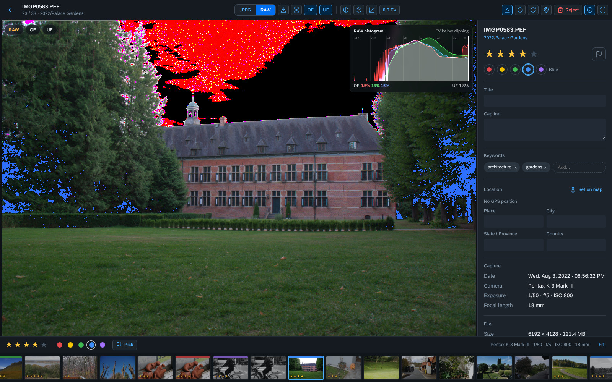
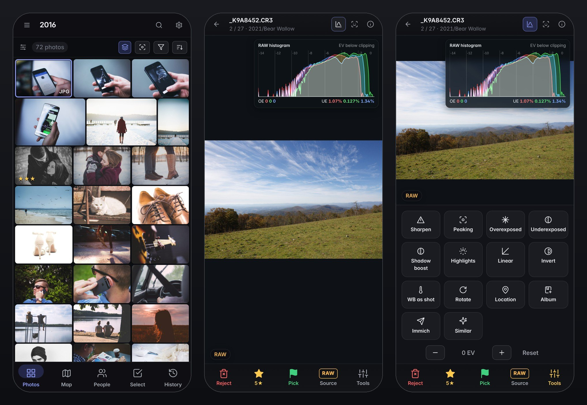

<p align="center">
  
</p>

<h1 align="center">Hyperfocal</h1>

<p align="center">
  Fast, self-hosted RAW photo culling and library management for Unraid and Docker.<br />
  FastRawViewer-style viewing and culling, Excire-style library management, and XMP that the other apps can read.
</p>


Hyperfocal indexes a plain `Year/Event` folder library of RAW files (CR2, CR3, DNG, NEF, ARW, RAF, RW2, PEF and more), JPEG and HEIC/HEIF, and lets you browse, check and cull it from any browser on your LAN, including your phone. It never modifies or deletes an original image file. Ratings, labels, picks, keywords, captions and locations go into standard XMP sidecars, and rejected photos are moved into a `_Rejected` sub-folder.

## Contents

- [Features](#features)
- [Safety](#safety)
- [Screenshots](#screenshots)
- [Install on Unraid](#install-on-unraid)
- [Docker Compose](#docker-compose)
- [Behind Nginx Proxy Manager](#behind-nginx-proxy-manager)
- [Working alongside Excire Foto, Lightroom and Bridge](#working-alongside-excire-foto-lightroom-and-bridge)
- [Keyboard shortcuts](#keyboard-shortcuts)
- [Configuration](#configuration)
- [Performance](#performance)
- [Limitations](#limitations)
- [Troubleshooting a file](#troubleshooting-a-file)
- [Development](#development)
- [Roadmap](ROADMAP.md)
- [Credits](#credits)

## Features

### Viewing and culling (FastRawViewer-style)

- **Embedded JPEG or real RAW, on one key (`J`).** The camera JPEG appears instantly. The RAW view is developed from the sensor data, so what you judge is the real file, not the camera's rendering.
- **Two RAW decoders.** FlashRaw reads RAW files first, in-process. When it cannot read a file (a camera newer than it, or a damaged file), LibRaw takes over. A RAW view drawn by LibRaw says so on its histogram.
- **HEIC/HEIF** from phones and from cameras that shoot `.HIF`. Colours are converted properly: Display P3 to sRGB, and HDR (PQ/HLG) tone-mapped to SDR. RAW+HEIF pairs are grouped like RAW+JPEG.
- **View tools that never touch the file.** Every tool only changes what you see:
  - two levels of screen sharpening
  - focus peaking
  - over- and underexposure overlays
  - shadow boost
  - highlight inspection
  - linear mode
  - white balance (as shot, daylight or auto)
  - exposure correction in ⅓ and 1 EV steps
- **Clipping measured on the raw data,** before white balance, per channel. This is the same idea as FastRawViewer's RAW-based over/underexposure display. The RAW histogram is drawn in EV below clipping, with the percentage of clipped pixels per channel.
- **Rate, label, pick, reject.** Ratings 0–5, colour labels, pick and reject flags.
  - Rejecting moves the photo, its sidecar and its JPEG/HEIF twin into a `_Rejected` sub-folder next to it, the way FastRawViewer does. A different photo that only shares the name (a TIFF saved as `IMG_1234.tif`, say) stays put.
  - Restore moves it back, and `Ctrl+Z` undoes anything.
- **Fast navigation.**
  - The next photos are prefetched.
  - High-priority requests jump ahead of background work.
  - Developed RAW data stays in RAM, so switching between view tools takes 30–70 ms.
- **Keyboard first.** You can pick FastRawViewer's default shortcuts or a Lightroom / Excire preset. Plain `0–5` and `6–9` work in both.

### Library management (Excire-style)

- **Your folders, as they are.** The Year/Event (or Year/Month) tree is shown exactly as it is on disk. Any folder can be viewed with or without its sub-folders.
- **Quick collections:** Picks, Five stars, Without location, All rejected.
- **Search and filters.**
  - Full-text search covers file name, folder, title, caption, keywords, place, camera and lens.
  - Filters cover rating, label, pick state, file type, camera, lens, keyword, date range and GPS.
  - Sort by capture time, name, rating, modification date or size.
- **XMP and IPTC editing.**
  - Fields: title, caption, creator, copyright, keywords (including `Places|Portugal|Lisbon` hierarchies), sub-location, city, state and country.
  - Edit one photo, or select many and edit them all at once.
- **Locations.**
  - Place photos on a map by clicking it or searching for a place name. City, state and country are filled in from the position (you can turn this off).
  - Works in bulk for any selection.
  - The map view shows the whole library, clustered.
- **History.** Every change is journaled with what it changed from and to, and can be undone from the History dialog.
- **Live updates.** Changes made in another tab, or picked up from disk, appear immediately.

### Interface

- Dark and light themes. The design uses SAP's Horizon colours and the 72 typeface, with layout ideas from [Augenblick](https://github.com/orohde/Augenblick).
- A mobile layout built for one-handed culling:
  - bottom navigation
  - a reject / rate / pick / RAW-JPEG action bar
  - a tools sheet
  - swipe navigation
- Can be added to the home screen as an app (web app manifest; browsers require HTTPS for this, for example through your reverse proxy).
- Optional password. All URLs are relative, so it also works under a sub-path.

## Safety

Hyperfocal was written for an archive that must not be damaged. These rules are enforced in code:

1. **Original image files are never opened for writing and never deleted.** There is no delete function anywhere in the app or the API. The only thing that can happen to an original is a rename-only move into or out of `_Rejected`.
2. **Only two kinds of change exist:**
   - writing XMP sidecars (`IMG_1234.xmp`)
   - moving a photo group between its folder and that folder's `_Rejected` sub-folder
3. **Sidecars are backed up before every change** to `/config/backups/sidecars/`, and every change is journaled, so each one can be undone.
4. **Moves are rename-only.**
   - They use `renameat2(RENAME_NOREPLACE)`, so a move can never overwrite an existing file.
   - A group move is all-or-nothing and rolls back on any error.
   - A move is never turned into copy-then-delete. A move that would cross file systems is refused.
5. **Metadata writes re-read the sidecar first and change only the fields you edited.** Edits you made in Excire or Lightroom in the meantime are kept, and undo restores only the fields Hyperfocal changed.
6. **The library is never chowned or chmodded.** The container only takes ownership of its own `/config` folder.
7. **The C decoders run outside the server.**
   - libheif (HEIC) and LibRaw run only in a short-lived helper process that reads one file and exits. It is killed if it takes longer than three minutes.
   - If one of them crashes or hangs on a damaged file, only that request fails: the server, the indexer and your files are unaffected. These libraries do get security fixes from time to time, which is why they are kept at arm's length.
   - FlashRaw, the JPEG code and the HEIF metadata reader are memory-safe Rust and run in-process. A decoder that panics on a malformed file is caught too.
8. **Read-only mode** turns every write off. It is used automatically when the library is mounted read-only or ExifTool is unavailable, and can be forced with `HYPERFOCAL_READONLY=true`.

An end-to-end test runs every write path against a scratch library and compares every original byte for byte afterwards. It runs in CI on every push. The write paths it covers:

- bulk metadata edits
- merging into an existing Excire sidecar while keeping its other fields
- rejecting a RAW+JPEG+HEIF set
- two different photos with the same name (RAW and TIFF, CR3 and DNG): edits, rejects and restores of one never touch the other's files or sidecar
- a reject that would overwrite a file, which must be refused
- restore
- undo
- read-only mode

## Screenshots

| RAW view with over/underexposure and the RAW histogram | Map |
| --- | --- |
|  |  |

Mobile: grid, single view with the culling bar, view tools:



<sub>The demo library is made of CC0 sample files from [raw.pixls.us](https://raw.pixls.us/).</sub>

## Install on Unraid

1. Open a terminal on the server (the `>_` icon in the Unraid web UI) and save the template:
   ```bash
   wget -O /boot/config/plugins/dockerMan/templates-user/my-Hyperfocal.xml \
     https://raw.githubusercontent.com/au12/Hyperfocal/main/unraid/hyperfocal.xml
   ```
   Or copy [`unraid/hyperfocal.xml`](unraid/hyperfocal.xml) to that path by hand.
2. Go to **Docker**, click **Add Container**, and choose **Hyperfocal** in the **Template** list.
3. Set **Photo library** to the share that holds your Year folders, for example `/mnt/user/Photos`.
4. Keep **AppData** on your cache pool. The index database and the thumbnail cache live there. `/mnt/cache/appdata/hyperfocal` is best if `appdata` is not an exclusive share.
5. Click **Apply**, then open the web UI.

The first scan indexes metadata only and reads very little of each file. Thumbnails are built in the background, newest years first. Any folder you open is indexed immediately, ahead of the queue.

The image is `ghcr.io/au12/hyperfocal:latest` (amd64). It is rebuilt on every push to `main` and once a week, so security fixes in Debian's packages (including libheif and LibRaw) reach it without a code change. Tags `vX.Y.Z` are published as versioned images. In a public repository, GitHub pauses scheduled workflows after 60 days without activity; if that happens, re-enable the **Docker** workflow in the **Actions** tab.

The container package has the same visibility as the repository. If the repository is private, the image is private too. In that case, either make the package public (GitHub → Packages → hyperfocal → Package settings) or run `docker login ghcr.io` on the server with a token that has `read:packages`.

## Docker Compose

```yaml
services:
  hyperfocal:
    image: ghcr.io/au12/hyperfocal:latest
    container_name: hyperfocal
    ports:
      - "8080:8080"
    volumes:
      - /mnt/user/Photos:/photos             # add :ro for a pure viewer
      - /mnt/user/appdata/hyperfocal:/config
    environment:
      PUID: "99"
      PGID: "100"
      UMASK: "000"
      # HYPERFOCAL_PASSWORD: "change-me"
    restart: unless-stopped
```

## Behind Nginx Proxy Manager

Add a proxy host pointing at `http://<unraid-ip>:8080`. Nothing else is required. The live-update stream sends `X-Accel-Buffering: no`, so nginx does not buffer it.

To keep it LAN-only, add an Access List in NPM that allows only your LAN subnet and denies everything else, and attach it to the host, or give it a DNS name that only resolves inside your network. Set `HYPERFOCAL_PASSWORD` if other people share the network.

The browser fetches the map tiles and the place search directly from OpenStreetMap (`tile.openstreetmap.org`, `nominatim.openstreetmap.org`). Nothing else leaves your network.

## Working alongside Excire Foto, Lightroom and Bridge

Hyperfocal reads EXIF, embedded XMP and sidecar XMP, in that order, so sidecar values win. It writes standard fields:

| What | XMP field | Read by |
| --- | --- | --- |
| Rating | `xmp:Rating` | Excire, Lightroom, Bridge, Capture One, darktable |
| Colour label | `xmp:Label` (`Red`, `Yellow`, …; localized names such as `Rot` are read too) | Excire, Lightroom, Bridge |
| Pick flag | `xmpDM:pick`, the field Lightroom Classic 13.2+ uses | Lightroom |
| Reject rating (`Alt+Delete`) | `xmp:Rating` = −1, Bridge's reject | Bridge |
| Keywords | `dc:subject` and `lr:hierarchicalSubject` | all of the above |
| Title, caption, creator, copyright | `dc:title`, `dc:description`, `dc:creator`, `dc:rights` | all of the above |
| Location | `exif:GPS*`, `photoshop:City/State/Country`, `Iptc4xmpCore:Location/CountryCode` | all of the above |

Sidecars are named `IMG_1234.xmp`, the Adobe convention that Excire also uses. Darktable- and digiKam-style `IMG_1234.CR3.xmp` sidecars are renamed to `IMG_1234.xmp` when the folder is scanned, so Excire and Lightroom see their ratings and keywords too. The content is not touched. A sidecar is only renamed when nothing can mix: the photo is the only one with that name (apart from its JPEG/HEIF twin) in its folder and `_Rejected`, and no `IMG_1234.xmp` exists yet. When one does, both files stay and `IMG_1234.xmp` is used. Each rename shows up in the history and can be undone, which keeps the old name for good. Set `HYPERFOCAL_RENAME_SIDECARS=false` if you still edit in darktable: it keeps its edit history in that file and only looks for it under the darktable name.

A RAW and a JPEG or HEIF with the same name in the same folder are one photo, shown once with a `CR3+JPG` badge, and share `IMG_1234.xmp`. Two *different* photos with the same name never share a sidecar: `IMG_1234.xmp` belongs to the RAW (a camera RAW before a DNG, then JPEG, HEIF, TIFF, PNG), and the other photo gets its own, such as `IMG_1234.TIF.xmp` for a TIFF saved under the RAW's name or `IMG_1234.DNG.xmp` for a DNG converted from a CR3. This holds while either one is in `_Rejected`, so a reject or restore never changes which sidecar a photo uses.

**Excire Foto setup for two-way sync:**

- **Enable "Always use sidecar files"** in Excire's settings. Excire always writes RAW metadata to sidecars, but by default it writes JPEG and DNG metadata into the file itself. Hyperfocal never writes into your DNGs, so with this option on, both apps use the same sidecar for DNGs too.
- **Enable "Load keywords from analyzed photos"** on the Metadata tab of Excire's settings, so Excire reads keywords that are already in your files.
- Excire keeps its changes in its own database until you save them. Use **Save Metadata** to write Excire's edits to the sidecars; Hyperfocal picks them up on the next rescan, or as soon as you open the folder. Use **Load Metadata** in Excire to pull in changes made in Hyperfocal.

Lightroom works the same way: use *Metadata → Save Metadata to File* and *Read Metadata from File*.

## Keyboard shortcuts

The FastRawViewer preset is the default. Press `?` in the app for the full list. Switch to the Lightroom / Excire preset under Settings.

| Action | FastRawViewer preset | Lightroom / Excire preset |
| --- | --- | --- |
| Next / previous photo | `→` `Space` / `←` `Backspace` | same |
| Open / back to grid | `Enter` / `Esc`, `G` | same |
| RAW ↔ embedded JPEG | `J` | `J` |
| Fit ↔ 100 % | `Z` | `Z` |
| Screen sharpening (off / 1 / 2) | `S` | `S` |
| Focus peaking | `P` | `Shift+P` |
| Overexposure / underexposure | `O` / `U` | `O` / `Shift+U` |
| Shadow boost / highlight inspection / linear | `Shift+S` / `Shift+H` / `Shift+L` | same |
| Exposure ±⅓ EV, ±1 EV, on/off | `Alt+=` `Alt+-`, `Ctrl+Alt+=` `Ctrl+Alt+-`, `A` | same |
| Histogram / info panel | `H` / `I` | same |
| Rating | `0`–`5` | `0`–`5` |
| Colour label | `6` red, `7` yellow, `8` green, `9` blue | same |
| Pick / unflag | `Alt+P` or `` ` `` / `Alt+U` | `P` / `U` |
| Reject (move to `_Rejected`) | `Delete` | `X` or `Delete` |
| Keywords / location / title | `K` / `L` / `Alt+D` | same |
| Undo | `Ctrl+Z` | `Ctrl+Z` |
| Map | `M` | `M` |
| Search | `/` | `/` |

## Configuration

| Variable | Default | Meaning |
| --- | --- | --- |
| `HYPERFOCAL_PHOTOS` | `/photos` | Library root inside the container |
| `HYPERFOCAL_CONFIG` | `/config` | Index database, caches, sidecar backups, journal |
| `HYPERFOCAL_CACHE` | `$HYPERFOCAL_CONFIG/cache` | Thumbnail and preview cache |
| `HYPERFOCAL_PORT` | `8080` | HTTP port |
| `HYPERFOCAL_PASSWORD` | – | Optional single password for the UI |
| `HYPERFOCAL_READONLY` | `false` | `true` disables every write |
| `HYPERFOCAL_RENAME_SIDECARS` | `true` | Rename darktable/digiKam-style `IMG_1234.CR3.xmp` sidecars to `IMG_1234.xmp` (see [Working alongside Excire Foto](#working-alongside-excire-foto-lightroom-and-bridge)) |
| `HYPERFOCAL_REJECT_DIR` | `_Rejected` | Reject sub-folder name. `_rejected` in any case is always treated as a reject folder. |
| `HYPERFOCAL_RESCAN_MINUTES` | `15` | Full re-check interval (`0` = only at start-up) |
| `HYPERFOCAL_PREGEN_THUMBS` | `true` | Build all thumbnails in the background |
| `HYPERFOCAL_RAW_CACHE_MB` | `1536` | RAM for developed RAW data |
| `HYPERFOCAL_PREVIEW_CACHE_MB` | `4096` | Disk budget for screen-size previews |
| `HYPERFOCAL_INDEX_THREADS` | cores, 2–8 | Parallel metadata readers |
| `HYPERFOCAL_DECODE_CONCURRENCY` | cores ÷ 4, 1–4 | RAW files developed at once |
| `HYPERFOCAL_RAW_DECODER` | `auto` | `auto`: FlashRaw, with LibRaw when FlashRaw cannot read a file. `libraw`: LibRaw for every RAW file. |
| `PUID` / `PGID` | `99` / `100` | User and group the app runs as (Unraid `nobody:users`) |
| `UMASK` | `000` | `000` matches Unraid share permissions, so Excire can still edit sidecars over SMB |

Viewer and culling preferences are set per browser in the app's Settings dialog. They include the theme, shortcut preset, whether single view opens as JPEG or RAW, auto-advance, prefetch depth, sharpening strengths, the peaking colour and the overexposure style.

## Performance

These numbers are from a 2-vCPU test VM; an Unraid server will be faster.

| Operation | Time |
| --- | --- |
| Embedded full-size JPEG | 2–5 ms |
| Screen-size preview, first time | 60–105 ms (then cached on disk) |
| First RAW render, half-size development | 180–550 ms |
| Switching between view tools | 30–70 ms |
| Clipping mask | 4 ms |

The server is a single Rust binary (axum, SQLite in WAL mode, FlashRaw, libjpeg-turbo with SIMD). The UI is about 70 KB of compressed Svelte 5; the map loads only when you use it. The image is Debian slim plus ExifTool, which is used only to write sidecars, and libheif and LibRaw for the helper process.

On the same VM, the LibRaw helper starts in a few milliseconds, and a LibRaw development takes 0.1–2 s depending on sensor size. A HEIC thumbnail or preview costs one HEVC decode, about 0.5 s for a 12-megapixel photo; after that it is cached like everything else.

## Limitations

- The RAW view is developed at half resolution (a 2×2 Bayer quad per pixel). That is plenty for judging exposure and focus at screen size. For pixel-level checks at 100 %, the embedded JPEG view shows the camera JPEG at full resolution.
- Fujifilm X-Trans, monochrome and linear DNG files use an approximate development path, about 0.6–0.9 s.
- HEIC/HEIF files get the image view, metadata and every culling feature, but none of the RAW tools: they hold no sensor data.
- LibRaw 0.21, the version in the Docker image, has no colour data for some cameras released after 2022. FlashRaw handles those, but if LibRaw has to take over for one, its RAW view can look flat in colour.
- Hyperfocal does no AI tagging, face recognition, similarity search or duplicate detection. Keep Excire for those for now.

## Troubleshooting a file

`hyperfocal inspect` shows what every decoder makes of a file: metadata from FlashRaw and LibRaw, both developments with timings and clipping, the embedded previews, and for HEIC the decoded size and colour space. It only reads the file.

```bash
docker exec hyperfocal hyperfocal inspect "/photos/2024/Trip/IMG_0001.CR3"
# add --render /config/inspect to also save the RAW developments as JPEGs
```

## Development

```bash
# server (Rust 1.85+; cmake, nasm, pkg-config, libclang, libheif-dev, libraw-dev; exiftool at runtime)
#   Debian/Ubuntu: apt install cmake nasm pkg-config libclang-dev libheif-dev libheif-plugin-libde265 libraw-dev libimage-exiftool-perl
#   without libheif/LibRaw: cargo build --no-default-features (or --features heic / --features libraw)
cd server && cargo test && cargo run --release
#   env: HYPERFOCAL_PHOTOS=/path/to/library HYPERFOCAL_CONFIG=./dev HYPERFOCAL_WEB=../web/dist HYPERFOCAL_PORT=8099

# web UI (Node 20.19+)
cd web && npm ci && npm run dev     # proxies /api to :8099
npm run check && npm run build      # type check and production build (precompressed)

# image
docker build -t hyperfocal .
```

The GitHub Action in `.github/workflows/docker.yml` runs the tests, builds the image and publishes it to GHCR. The HEIC and DNG test fixtures are generated by `server/tests/fixtures/make_fixtures.py`.

## Credits

- [FlashRaw](https://crates.io/crates/flashraw): RAW decoding
- [LibRaw](https://www.libraw.org/) (LGPL-2.1 / CDDL): fallback RAW decoding
- [libheif](https://github.com/strukturag/libheif) and [libde265](https://github.com/strukturag/libde265) (LGPL-3.0): HEIC/HEIF decoding
- [libjpeg-turbo](https://libjpeg-turbo.org/): JPEG decoding and encoding
- [ExifTool](https://exiftool.org/) by Phil Harvey: sidecar writing
- [Leaflet](https://leafletjs.com/) and [OpenStreetMap](https://www.openstreetmap.org/copyright): maps
- [Nominatim](https://nominatim.org/): place search
- [SAP 72 font](https://github.com/SAP/theming-base-content) (Apache-2.0) and Horizon design tokens
- [Augenblick](https://github.com/orohde/Augenblick): design inspiration
- [FastRawViewer](https://www.fastrawviewer.com/) and [Excire Foto](https://excire.com/): the workflows this follows
- Sample photos in the screenshots: [raw.pixls.us](https://raw.pixls.us/) (CC0)

## License

MIT. See [LICENSE](LICENSE). The Docker image also contains LibRaw, libheif and libde265, used as unmodified shared system libraries under their own licenses.
