<p align="center">
  
</p>

<h1 align="center">Hyperfocal</h1>

<p align="center">
  Fast, self-hosted RAW photo culling and library management for Unraid and Docker.<br />
  FastRawViewer-style viewing and culling, Excire-style library management, and XMP that the other apps can read.
</p>

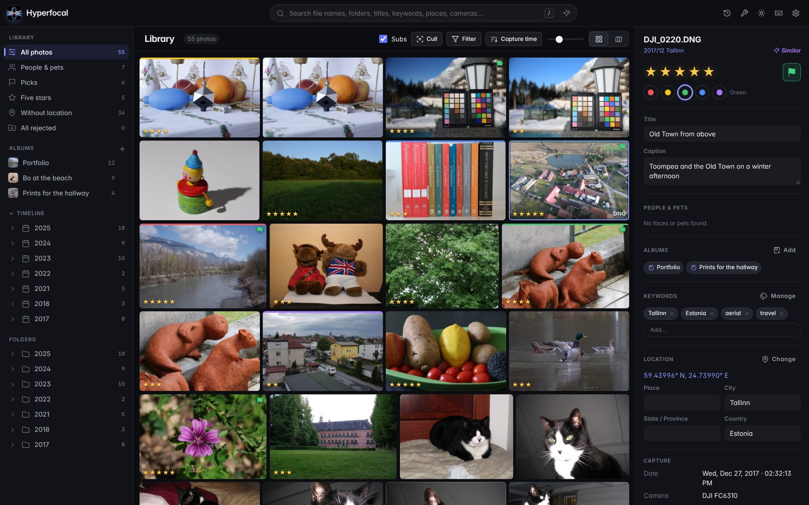

Hyperfocal indexes a plain `Year/Event` folder library of RAW files (CR2, CR3, DNG, NEF, ARW, RAF, RW2, PEF and more), JPEG and HEIC/HEIF, and lets you browse, check and cull it from any browser on your LAN, including your phone. It never modifies or deletes an original image file. Ratings, labels, picks, keywords, captions and locations go into standard XMP sidecars, and rejected photos are moved into a `_Rejected` sub-folder. Culling help shows each burst as one stack topped by its best frame, and flags blurry frames and clipping, measured on the RAW. Its built-in AI features also spot closed eyes, find photos by what they show, and find the people, dogs and cats in your photos, group them by who they are and write the names you give them to the sidecars, on the CPU or an NVIDIA GPU, without anything leaving your server.

## Contents

- [Features](#features)
- [People & pets](#people--pets)
- [Send to Immich](#send-to-immich)
- [Safety](#safety)
- [Screenshots](#screenshots)
- [Install on Unraid](#install-on-unraid)
- [Docker Compose](#docker-compose)
- [Behind Nginx Proxy Manager](#behind-nginx-proxy-manager)
- [Working alongside Excire Foto, Lightroom and Bridge](#working-alongside-excire-foto-lightroom-and-bridge)
- [Keyboard shortcuts](#keyboard-shortcuts)
- [Configuration](#configuration)
- [Performance](#performance)
- [Limitations](#limitations)
- [Troubleshooting a file](#troubleshooting-a-file)
- [Debug mode and telemetry](#debug-mode-and-telemetry)
- [Development](#development)
- [Roadmap](ROADMAP.md)
- [Credits](#credits)

## Features

### Viewing and culling (FastRawViewer-style)

- **Embedded JPEG or real RAW, on one key (`J`).** The camera JPEG appears instantly. The RAW view is developed from the sensor data, so what you judge is the real file, not the camera's rendering.
- **Two RAW decoders.** FlashRaw reads RAW files first, in-process. When it cannot read a file (a camera newer than it, or a damaged file), LibRaw takes over. A RAW view drawn by LibRaw says so on its histogram.
- **Full-resolution RAW for focus checks.** Zoomed in to 75% or more, the RAW view switches from half resolution to the full sensor resolution, demosaiced with RCD (the algorithm RawTherapee and darktable use) one tile at a time, nearest the centre first. Tiles are demosaiced on your device's graphics chip (instant exposure and tone changes) or on the server (smaller JPEG tiles); *Auto* uses the graphics chip on computers and the server on phones. Both give the same pixels to within one level.
- **Zoom tiles for everything else.** JPEG, HEIC, TIFF and PNG files, and a RAW file's embedded JPEG, zoom in through tiles too: past what the largest preview shows, the viewer asks only for the tiles in view, at a level of a pyramid (full size and its halvings) that fits the zoom, so a 45–100 MP image pans at 1:1 without ever loading whole.
- **Compare view.** Select 2–4 photos and press `C` to see them side by side, with zoom and pan synced at 100% (1:1 pixels) or separate. The active photo takes ratings, labels, picks and rejects; `↑`/`↓` steps it through the folder against the others, which makes picking the sharpest frame of a burst quick.
- **HEIC/HEIF** from phones and from cameras that shoot `.HIF`. Colours are converted properly: Display P3 to sRGB, and HDR (PQ/HLG) tone-mapped to SDR. RAW+HEIF pairs are grouped like RAW+JPEG.
- **View tools that never touch the file.** Every tool only changes what you see:
  - two levels of screen sharpening
  - focus peaking
  - over- and underexposure overlays
  - shadow boost
  - highlight inspection
  - linear mode
  - inverted colours
  - white balance (as shot, daylight or auto)
  - exposure correction in ⅓ and 1 EV steps
- **Calibrated against FastRawViewer.** The RAW rendering in every mode (normal, linear, shadow boost, highlight inspection), both sharpening levels and the exposure statistics were matched to FastRawViewer screenshots and stats of the same file.
- **Clipping measured on the raw data,** before white balance, per channel. This is the same idea as FastRawViewer's RAW-based over/underexposure display.
  - Canon's own white levels are read from the maker note, so pulled ISOs (160, 320, 640, 1250 …) clip where the sensor really does, not at the nominal 14-bit maximum.
  - The exposure stats count a sample as clipped where FastRawViewer does: for Canon, from 1.083 times the level that renders white; otherwise within 0.05 EV of saturation. Underexposed means a signal of less than 62 above black (14-bit scale), FastRawViewer's default.
  - The overexposure overlay marks from 0.22–0.45 EV below saturation, like FastRawViewer's, and it **follows the exposure correction**: at +1 EV it shows what would have clipped with a stop more exposure, and a negative correction shrinks it to what is clipped in the RAW data, never less.
  - Overlays are per channel: cyan, magenta or yellow for a clipped channel, red, green or blue for an underexposed one.
  - The RAW histogram is drawn in EV below clipping, with the share of clipped and underexposed samples per channel.
- **Rate, label, pick, reject.** Ratings 0–5, colour labels, pick and reject flags.
  - Rejecting moves the photo, its sidecar and its JPEG/HEIF twin into a `_Rejected` sub-folder next to it, the way FastRawViewer does. A different photo that only shares the name (a TIFF saved as `IMG_1234.tif`, say) stays put.
  - Restore moves it back, and `Ctrl+Z` undoes anything.
- **Fast navigation.**
  - The next photos are prefetched, in the direction you are going.
  - Hold an arrow key to scrub: every photo shows as you pass it, from its thumbnail (loaded well ahead), and the full image loads as soon as you let go or stop. Only thumbnails load for the photos passed on the way, so the view never falls behind.
  - High-priority requests jump ahead of background work.
  - Developed RAW data stays in RAM, so switching between view tools takes 30–70 ms.
- **Selection like a file manager.** Click selects one photo, `Ctrl`/`⌘`-click adds or removes one, `Shift`-click selects a range (repeat it to grow or shrink the range), and dragging draws a selection rectangle (with `Shift` to add, `Ctrl`/`⌘` to toggle; the grid scrolls at the edges). `Shift` with the arrows, `Home`/`End` or `PgUp`/`PgDn` extends from the keyboard. A plain arrow key moves on to a single photo, as in Finder, Explorer and Lightroom.
- **Keyboard first.** You can pick FastRawViewer's default shortcuts or a Lightroom / Excire preset. Plain `0–5` and `6–9` work in both. Any shortcut can be changed in the shortcuts dialog (`F1`), and reset to the defaults.

### Culling help (Excire-style)

Turn culling on with **Cull** in the toolbar (`Shift+C`). Nothing is ever rejected for you: what Hyperfocal finds is shown and filtered, and every reject is still yours, undoable as always.

- **Series as stacks.** Each burst, run of attempts or panorama sweep at one moment becomes one tile showing its best frame and how many frames it holds. Frames up to 2 seconds apart stay together unless the scene clearly changes; after a longer pause (up to a minute) they must look alike, more so the longer the pause, judged by search by content's visual fingerprint and the perceptual hash. `Shift+G` unfolds a stack in place; *Unfold all* opens them all. The best frame is the one you rated or picked, else the one with the fewest closed eyes, then the sharpest.
- **Series review.** `Enter` or `R` on a stack (or a click on its count, or *Review N series*) shows the series' frames side by side, as large as the screen allows, with each frame's sharpness and problems and the best one marked, and why. `←`/`→` go through the frames, `↑`/`↓` to the series before and after, `Enter` opens a frame (the single view, its arrows and its filmstrip stay within the series), `Esc` goes back to the library on the series. **Keep best** (`Shift+K`) keeps the best frame, moves the rest to `_Rejected` as one undoable move and goes on to the next series; a frame can also be kept or rejected from its tile, or several selected frames kept together.
- **Possible rejects.** Every photo is measured once in the background (the ones on screen first), and the grid marks what may be wrong with it: *Blurry*, *Eyes closed*, *Clipped* or *Too dark*. The culling bar filters by them, alone or together with *Weaker frames* (every frame of a series but its best), so a shoot's likely rejects can be checked in one pass.
- **Sharpness of the subject, from the RAW.** Sharpness is measured where it matters: on the faces, else on the sharpest part of the frame, on the RAW's half-size development (one pixel per 2×2 sensor quad, so no demosaicing detail is invented). It compares how much each edge's energy drops when it is blurred a little more (a sharp edge loses a lot, a soft one hardly anything), along the strongest edges in four directions, with the sensor noise measured and taken out first so high ISO does not pass for detail. Scores are scaled to the same print size, so a 45 MP and a 20 MP frame compare fairly. Sort by *Sharpness* for the sharpest frames first, or reverse it for the softest.
- **Closed eyes.** With the AI features on (the default), every face large enough gets MediaPipe's face landmarks and blink scores; a photo where someone blinked or looked down is marked. Faces turned away are judged from the eye that is visible.
- **Faces side by side.** `V` in the single view lines up a close-up of every face across all frames of the series, each with its sharpness and eyes, the frame on screen outlined. The best frame for every person shows at a glance; click a face to go to its frame.
- **Clipping from the RAW data:** the share of the photo with a clipped channel, counted as the RAW histogram counts it. It is flagged from 5% (a blown sky or window, not a few speculars); the info panel shows any amount.
- **People filters.** How many people are in the photo (none, 1, 2, 3–5, 6+), portraits (one person, close) or groups (three or more), eyes open or closed. Faces too small to matter (under 2.5% of the frame's height) and doubtful detections, such as statues, are not counted.
- **Measurements in the info panel:** sharpness in words and as a score, and what it was measured on (the faces, a pet or the sharpest part); closed eyes; clipping and deep shadows; and the series the photo belongs to, its frames and its best one.
- **Advanced settings.** Settings → Advanced tunes the numbers behind all of this for your shooting: how series are cut (burst, longest pause, likeness after a pause, scene changes, fewest frames, mixed cameras) with a live preview of how many series they make of the folder open, how the best frame is chosen, when a photo counts as blurry, blinking, clipped or too dark, how close Find similar and search by content must be, and the Duplicates report's levels. The defaults were calibrated on a hand-labelled real shoot (669 RAWs: an event, wildlife, pets, flowers, the moon): 98% of the frames that belong together are joined, with no two scenes mixed.

### Library management (Excire-style)

- **Your folders, as they are.** The Year/Event (or Year/Month) tree is shown exactly as it is on disk. Any folder can be viewed with or without its sub-folders.
- **Timeline and saved collections.** Browse by capture date across folders (year, month, day), and save any search and filter combination as a collection, such as "5★ picks from 2019 with no location". Quick collections: Picks, Five stars, Without location, All rejected.
- **Albums.** Hand-picked photos from anywhere in the library, in an order of their own. `B` adds the photos you are on (or the selection) to the album you used last, `Shift+B` picks or creates one by typing, `Alt+B` takes photos out of the album shown. In an album, drag photos (or a selection) into place; a cover, a note and the albums' own order in the sidebar are yours to set. Albums only point at photos: deleting one, or taking a photo out, never moves or deletes a file, and every change can be undone from History. A photo moved or renamed by another app keeps its place, and is found again when a file with the same name and size turns up. Albums live in the index (back up `/config`), not in the sidecars.
- **Search and filters.**
  - Full-text search covers file name, folder, title, caption, keywords, place, camera and lens.
  - Filters cover rating, label, pick state, file type, camera, lens, keyword, date range, GPS, people (how many, portraits or groups, eyes) and possible rejects.
  - Sort by capture time, name, rating, modification date, size or sharpness.
- **XMP and IPTC editing.**
  - Fields: title, caption, creator, copyright, keywords (including `Places|Portugal|Lisbon` hierarchies), sub-location, city, state and country.
  - Edit one photo, or select many and edit them all at once.
- **Library tools** in the sidebar: Keywords, Geotag from a track, Duplicates and Archive integrity (with its count of problems), described below.
- **Keyword manager.** Rename, move, merge and remove keywords across the whole library, hierarchies included, as one background change that can be undone as a whole.
- **Locations.**
  - Place photos on a map by clicking it or searching for a place name (`Shift+L`). City, state and country are filled in from the position (you can turn this off).
  - Works in bulk for any selection.
  - **Locations** in the sidebar (or `M`) shows every photo with a location on a map, clustered; the search field and the filters narrow it. Click a group to zoom in, or a photo to open it over the map. `M`, `G` or `Esc` goes back to the photos you were looking at.
- **Geotag from a track.** Load GPX, KML, TCX or NMEA files, or a phone's location history (Google Takeout's Records or Timeline export), and Hyperfocal matches capture times against them. The camera's time zone is detected, clock drift can be corrected, and the result is previewed on a map before anything is written to the sidecars.
- **Archive integrity monitor.** Every original gets a content hash when it is first indexed and is verified again over time (a full pass every 90 days by default), in a nightly window and at a gentle read rate, so array disks are not kept spinning. Originals that changed, went missing or became unreadable are reported in the app and, optionally, through ntfy, Gotify or a webhook. For JPEG, HEIC and TIFF/DNG only the image data is hashed, so a metadata edit by another app is not reported as damage. A file moved to another folder is recognised by its hash. Report-only: nothing is ever repaired or deleted.
- **Search by content.** Turn on the ✦ AI switch in the search field and describe what is in the photo — "dog on the beach", "candles on a cake", "red car at night", in English or the other languages SigLIP 2 learned — and the best matches come first, combined with any filter, folder or album. *Find similar* (single view, info panel, selection menu) shows the photos that look most like one. Every photo is looked at once in the background by the built-in AI engine (newest first; the header says how far it has got), from its thumbnail, and nothing leaves your network. Its models (about 1 GB) are downloaded the first time.
- **Duplicates report.** Four searches, each for the whole library, one folder, or a folder against the rest of the library (Excire's scopes):
  - *Exact copies* come from the integrity monitor's content hashes. For JPEG, HEIC, TIFF and DNG only the image data is hashed, so a copy that another app wrote a caption or keywords into still counts as a copy; a whole-file comparison (Excire's exact mode) misses those.
  - *Near-duplicates* are resized, recompressed or re-exported copies and light edits, found by a 64-bit perceptual hash of each photo's thumbnail, made in the background, and turned or mirrored copies, found through the hashes of each photo's seven turned and mirrored versions. Strict, normal and loose levels.
  - *Look-alikes* (with search by content on) are found by what the photos show: crops, edits, other renderings and mirror images that pixel fingerprints miss, each with how alike it is. Over the whole library this uses an inverted-file index, a few seconds for 300,000 photos.
  - *Series* are bursts, brackets and runs of attempts, as culling finds them (Settings → Advanced); a shorter or longer pause can be picked for the report.
  - Each group suggests a keeper (RAW over JPEG, then the most pixels, then the most metadata; in a series the frame you rated or picked, else the sharpest) and says why. Click another photo to keep it instead, open the group in the compare view, mark it "not duplicates", or move the others to `_Rejected` with one click, journaled and undoable like any reject. Only exact copies can be rejected all at once (*Reject all but the keepers*): near-duplicates, look-alikes and series are different files, so each group is rejected on its own, after a look. A RAW and its JPEG twin count as one photo.
- **Send to Immich.** Select photos (or an album) and send them to your Immich server, into a new or existing Immich album. Photos Immich already has are used as they are, never uploaded twice: found by path when Immich reads this library as an external library, or by content when the same file was uploaded before. RAW files go as a full-size JPEG by default (the camera's own JPEG of a RAW+JPEG pair, or the JPEG inside the RAW, carrying capture time, camera, lens, GPS, rating and keywords), or as the original with its sidecar. Progress shows in the header; nothing in the library changes, and nothing in Immich is changed or deleted besides adding to the album. See [Send to Immich](#send-to-immich).
- **History.** Every change is journaled with what it changed from and to, and can be undone from the History dialog.
- **Live updates.** Changes made in another tab, or picked up from disk, appear immediately.

### People & pets

- **Faces, dogs and cats, recognised on your server.** Hyperfocal's AI engine finds them (on the CPU or an NVIDIA GPU) and matches each one against every face it knows. Nothing leaves your network. See [People & pets](#people--pets).
- **Name a group once.** Its photos get the name, and new photos of that person or pet are suggested for a yes or no. Merge, split, hide strangers, and filter the grid by a person.
- **Names go to the sidecars,** as `People|Name` and `Pets|Name` keywords, MWG face regions (Lightroom, digiKam) and IPTC "person shown", undoable like every other edit. Names other apps already wrote come in.
- **On the photo.** The info panel lists who is in a photo; `Shift+F` draws the faces and pets on the single view, where you can name them.
- **Set the detectors right.** Every face and animal has a menu (⋯, or a right-click). *Not a face* takes a false detection out of everything for good; *It's a dog* / *It's a cat* turns a pet's face that was taken for a person's into that animal, which then finds its pet.

### Interface

- Dark and light themes in a graphite-and-glass design set in Inter, with small animations for actions: the photo zooms out of its tile into the single view and back, the filmstrip slides, ratings and flags pop, filters and toggles glide, rejected photos fold out of the grid. Everything falls back to instant changes when the system asks for reduced motion. Layout ideas from [Augenblick](https://github.com/orohde/Augenblick).
- **Side panels your size.** Drag the edge between the sidebar or the info panel and the photos to resize it, or double-click it for the default width. The tab in the middle of the edge hides the panel, and brings it back from the edge of the window (`F7` for the sidebar, `I` for the info panel, `Tab` for both). The widths are kept in the browser.
- **Side panels in your order.** Right-click any section or entry of the sidebar or the info panel (hold it on a phone) to move it up or down or hide it. The same menu lists what is hidden, to show it again, and can reset the panel. Albums also get their own actions there, and keep the library's order (shared by every device); everything else is kept in the browser.
- A mobile layout built for one-handed culling:
  - bottom navigation
  - a reject / rate / pick / RAW-JPEG action bar
  - a tools sheet
  - swipe navigation
- Can be added to the home screen as an app (web app manifest; browsers require HTTPS for this, for example through your reverse proxy).
- **Offline copies.** Over HTTPS, the thumbnails, previews and folder lists you looked at stay viewable when the server cannot be reached (Settings → Offline; signing out clears them).
- Optional password. All URLs are relative, so it also works under a sub-path.

## People & pets

Hyperfocal finds the faces, dogs and cats in your photos, groups them by who they are and lets you name them. Names you confirm go to the sidecars, where Lightroom, digiKam and Excire read them. It is on by default and can be turned off (`HYPERFOCAL_ML_FACES=false`, or `HYPERFOCAL_ML=false` for every AI feature): everything else works as before, and names other apps wrote are still read.

### How it works

- **The models run inside Hyperfocal, in a process of their own** (the AI engine: ONNX Runtime, on the CPU or an NVIDIA GPU). The server hands it a 2048-pixel upright JPEG of each photo over a local connection and gets back boxes and embeddings. The engine never opens your library and keeps nothing; if it crashes (a GPU driver, say), the server restarts it and carries on. Its models are downloaded into your app data folder the first time (see [Setting it up](#setting-it-up)).
- **Faces:** YuNet at three scales (faces from about 0.6% to the whole of the frame), aligned on five landmarks, then AuraFace embeddings. Each face gets a quality from how recognisable it is: masked, blurred, tiny and turned-away faces must match much more closely to count.
- **Dogs and cats:** RF-DETR Small finds them, and a pet re-identification model (DINOv2-based) tells individual animals apart. A cat the detector took for a dog still finds its look-alikes. A face you said is a dog or a cat gets a pet embedding of its head (the face's box, framed as a face's crop is), so it finds its pet too.
- **Eyes, for culling:** each face of at least 64 pixels is cropped from the photo as culling measures it (a RAW's half-size development) and sent for MediaPipe's face landmarks and blendshapes, which give a blink score per eye, about 25 ms a face on the CPU.
- **Who is who is decided in Hyperfocal.** Every face is compared with every known face (int8 vectors in memory, AVX2, with a sign-code prefilter: 340 MB for 600,000 faces). Its closest look-alikes vote, confirmed faces count more, and a clear winner is needed: a near tie between two people is left for you. A person is in a photo at most once, and "not this person" is never overruled. Faces that match nobody form unnamed groups with their look-alikes. After the first analysis the groups are formed again, best faces first, which gives cleaner groups than the order the photos happened to be analysed in.
- **Photos on screen come first,** then the rest of the library. The analysis pauses while you view photos, can be paused from the People view, and resumes after a restart. A photo is analysed again only when the file, its orientation or the models change; names carry over.

### Naming and reviewing

- **People & pets** (sidebar, or `Shift+P`) shows the named people and pets, then the unnamed groups, most photos first. Open a group, type a name, press Enter: its photos are named and the next group opens (the arrows in its header step through the groups). Typing a name that already exists merges the two. The names suggested as you type show each person's face. With more than a few people, a search field finds them by name.
- **New photos of someone you named are suggested** ("Anna?") until you say yes or no. A banner at the top of the view counts them and opens the first person to review. Each person has a *To review* list, least sure first, each face with how alike it is, with *Yes, all* and per-face ✓ / ✕; *Next to review* goes on to the next person. Select faces (click; Shift-click for a range) to say they are not that person, to move them to someone else, or that they are not faces at all.
- **On a photo:** the info panel lists who is in it, with suggestions to confirm and unknown faces to name; pointing at a row outlines that face on the photo. `Shift+F` draws the boxes on the single view, where you can name them too. Click a name to see all of that person's photos (a filter you can combine with the others).
- **Every face and animal has a menu** (its ⋯ button, or a right-click) in a person's sheet, the info panel and on the photo: yes or no to a suggestion, someone else, all photos of them, and the corrections below.
- **Hide** a group of strangers (it keeps collecting them, out of sight), or **remove** a group (its faces become unknown again).
- **Every sidecar change is a history entry,** written in batches shortly after you name or confirm. Undoing one restores the sidecars and the names follow them back.

### Setting the detectors right

- **Not a face.** A pattern, a statue or a reflection taken for a face (or a toy for a dog): *Not a face* (*Not a dog or cat*) takes it out of the people and pets, the sidecars and culling (people counts, closed eyes, what sharpness is measured on), and it stays out when the photo is analysed again. *None of them are faces*, in an unnamed group's menu, does it for a whole group (a statue in every photo of a venue). The toast offers *Undo*, and the info panel lists what was marked on a photo, to point at (it is outlined on the photo) or restore.
- **It's a dog, It's a cat.** The face detector takes some dogs' and cats' faces for people's. Usually the animal detector finds the animal around it and the face is dropped, but not always. *It's a cat* turns such a face into a cat: it leaves the person it was given to (the name leaves the sidecar too), and the AI engine makes a pet embedding of its head, after which it is matched to your pets like any animal, a few seconds later. An unnamed group of them can be turned at once. It stays a cat when the photo is analysed again; *It's a dog* changes its species, and *It's a face after all* takes it back (the photo is then analysed again for the face).

### What is written

Only confirmed, named faces and pets are written, to the photo's sidecar:

| What | Where |
| --- | --- |
| A person | keyword `People\|Name` (`lr:hierarchicalSubject`, and `Name` in `dc:subject`) |
| A pet | keyword `Pets\|Name` |
| Where they are | MWG region (`mwg-rs:Regions`) of type `Face` or `Pet`, with the name |
| Who is shown | `Iptc4xmpExt:PersonInImage` (people) |

Going the other way, named face regions that Lightroom, digiKam or another app wrote name the face they cover when Hyperfocal analyses the photo, so names you already have carry over. A `People|Name` keyword with no region becomes a suggestion for the photo's only face. Taking a person's keyword off a photo by hand (in the info panel) means "not them": that face goes back to unknown. People and pets are renamed and merged in the People view, not in the keyword manager. Set `HYPERFOCAL_PEOPLE_XMP=false` to keep the names in Hyperfocal only.

### Setting it up

There is nothing to install: the AI features are part of the Hyperfocal image and on by default. On the first start the models are downloaded from their publishers into `/config/ml` (your app data folder), each checked against its sha256 before it is used, and the analysis starts as soon as they are in. The People & pets view and Settings show the download's progress.

| What | Download | Memory |
| --- | --- | --- |
| People & pets (faces, dogs, cats) | about 0.7 GB | about 1.2 GB |
| Search by content, Find similar, look-alikes | about 1 GB | 0.8 GB, 1.7 GB once a text search has loaded the text model |
| Closed eyes, for culling | none (7 MB, in the image) | about 60 MB |
| NVIDIA GPU runtime (ONNX Runtime's CUDA build, CUDA 13, cuDNN 9) | about 1.3 GB (2 GB on disk), only with a GPU | |

Only what is turned on is downloaded. To get the space back, turn a feature off and delete `ml` in the app data folder; what is still needed is fetched again.

**NVIDIA GPU (Unraid):** install the *Nvidia Driver* plugin (driver 580 or newer), then in the Hyperfocal template add `--runtime=nvidia` under **Extra Parameters** (Advanced View) and put your GPU's UUID (from the plugin's page) in **NVIDIA_VISIBLE_DEVICES**. With **AI device** on `auto` (the default), Hyperfocal uses the GPU when it can reach one and the CPU otherwise; Settings says which. The models' weights come to about 1.7 GB with every AI feature on (0.7 GB without search), so a 4 GB card is enough, and the GPU can be shared with Plex or Immich. With the GPU, set **photos in flight** to 3 or 4.

**Docker Compose:** see the commented `deploy` block in the [example](#docker-compose).

**Coming from the `hyperfocal-ml` container:** remove it, and `HYPERFOCAL_ML_URL` and `HYPERFOCAL_ML_TOKEN` from Hyperfocal (they are ignored now). The models and their preprocessing are the same, so nothing is analysed again.

AI settings (all optional):

| Variable | Default | Meaning |
| --- | --- | --- |
| `HYPERFOCAL_ML` | `true` | `false` turns every AI feature off: nothing is downloaded or run |
| `HYPERFOCAL_ML_DEVICE` | `auto` | `cpu`, `cuda`, or `auto` (an NVIDIA GPU when the container can reach one) |
| `HYPERFOCAL_ML_FACES` | `true` | People & pets (and the closed-eyes check, which looks at the faces found) |
| `HYPERFOCAL_ML_SEARCH` | `true` | Search by content, Find similar and look-alikes (`false`: 0.8–1.7 GB less memory) |
| `HYPERFOCAL_ML_EYES` | `true` | Culling's closed-eyes check |
| `HYPERFOCAL_ML_PET_DETECTOR` | `small` | `nano`: fewer small or half-hidden pets found, about 0.3 s a photo faster on a weak CPU (changing it analyses every photo again) |
| `HYPERFOCAL_ML_THREADS` | all cores | Threads per model on the CPU |
| `HYPERFOCAL_ML_WORKERS` | 1 (CPU), 2 (GPU) | Photos the engine analyses at once |
| `HYPERFOCAL_ML_GPU` | `0` | Which GPU, when the container sees several |
| `HYPERFOCAL_ML_GPU_MEM_MB` | – | Cap on the GPU memory ONNX Runtime takes |
| `HYPERFOCAL_ML_IDLE_MIN` | 15 (GPU), never (CPU) | Minutes without AI work before the engine stops and gives its memory back (on a GPU, all of it); the next search or new photo starts it again, in a few seconds. `0`: never |
| `HYPERFOCAL_ML_IDLE_NO_CLIENTS_MIN` | 2 (GPU), never (CPU) | The same while no browser has Hyperfocal open (a tab hidden for 2 minutes lets go). Background analysis keeps the engine awake until it is done. `0`: never |
| `HYPERFOCAL_ML_FACE_SCALES` | `1600,640,320` | Sizes faces are looked for at (long side, px) |
| `HYPERFOCAL_ML_DIR` | `$HYPERFOCAL_CONFIG/ml` | Where the models and the GPU runtime go |
| `HYPERFOCAL_ML_LOG` | `info` | The engine's log level (`debug` for more) |

### Speed

On the 2-vCPU test VM, a photo takes about 1–1.5 s on the CPU (faces at three scales, then dogs and cats), so a first pass over 100,000 photos takes a day and a half; a server CPU with more cores is proportionally faster, and new imports are analysed within minutes. The GPU was not measured on this VM.

Matching a new face against 600,000 known faces takes 3 ms there. Each face also keeps a 64-byte sign code (the signs of its vector after a fixed random rotation): codes are compared first, eight instructions each, and only faces whose codes are close enough are compared in full. That gives the same matches as comparing every vector (24 ms) but for about one in 2,000 right at the threshold. Forming the groups again matches faces in batches at about 1 ms a face against 600,000: 20 seconds for 100,000 faces and about 11 minutes for 600,000 (70 minutes without the codes). It runs after the first analysis and at most once a day after that, a chunk at a time, so your edits never wait for it.

### Models and licences

Every model is licensed for commercial use, downloaded from its publisher the first time it is needed, and checked against its sha256 (`server/src/ml/manifest.json`) before it is used. The two face-landmark models, which have no ONNX release, are converted once and kept in the repository (`ml/models`, with how they were made) and in the image:

| Model | Does | Licence |
| --- | --- | --- |
| [YuNet](https://github.com/opencv/opencv_zoo/tree/main/models/face_detection_yunet) 2026may (OpenCV Zoo) | finds faces and their landmarks | MIT |
| [AuraFace v1](https://huggingface.co/fal/AuraFace-v1) (ResNet100, ArcFace loss) | tells faces apart | Apache-2.0 |
| [RF-DETR](https://github.com/roboflow/rf-detr) Small / Nano (COCO) | finds dogs and cats | Apache-2.0 |
| [pet-recognition-base](https://huggingface.co/open-noodle/pet-recognition-base) | tells pets apart | Apache-2.0 |
| [SigLIP 2](https://huggingface.co/google/siglip2-base-patch16-224) base (Google; ONNX by onnx-community) | search by content, Find similar and look-alikes: image and text embeddings in one space | Apache-2.0 |
| [MediaPipe Face Landmarker](https://ai.google.dev/edge/mediapipe/solutions/vision/face_landmarker) v1: Face Mesh V2 and Blendshape V2 (Google; converted to ONNX) | closed eyes, for culling: face landmarks, then blink scores per eye | Apache-2.0 |

The engine runs them with [ONNX Runtime](https://onnxruntime.ai/) 1.29 (MIT): the CPU build is in the image; the CUDA build and NVIDIA's CUDA 13 and cuDNN 9 libraries (under NVIDIA's licences) are downloaded from PyPI, from the official wheels, only when a GPU is used. Its preprocessing reproduces OpenCV's (resizing, warping, rounding), so the thresholds tuned below hold: on test photos it finds the same faces and animals as the Python service it replaced, with the same scores and boxes and embeddings equal to within float16 rounding.

The face models most self-hosted apps use (InsightFace's `buffalo_l` and friends) are for non-commercial research only, so they are not used. AuraFace was trained on commercially licensed data and is a little less accurate than those on the hardest benchmarks; the matching thresholds were tuned on two weddings' worth of photos (crowds, veils, masks, profiles) to make few wrong suggestions rather than many groups.

## Send to Immich

Set `HYPERFOCAL_IMMICH_URL` and `HYPERFOCAL_IMMICH_API_KEY`, and *Send to Immich* appears in the selection bar's menu, the single view, and the albums' menus. Make the key in Immich under Account settings → API keys, with the permissions `asset.read`, `asset.upload`, `album.read`, `album.create` and `albumAsset.create`.

For each photo, Hyperfocal looks for it in Immich before uploading anything:

1. **Sent before:** the asset it became, while it is still there and the file has not changed since.
2. **In Immich's external library:** if Immich reads the same photo folder (an external library), set `HYPERFOCAL_IMMICH_LIBRARY_PATH` to the path Immich sees it at. A photo at `2019/Trip/IMG_1.CR3` is then looked up as `/mnt/media/photos/2019/Trip/IMG_1.CR3`, and used as it is.
3. **Uploaded before:** by its content (SHA-1), from Hyperfocal, the Immich CLI or a phone.

Only photos found nowhere are uploaded. A RAW file goes as a full-size JPEG (choose *Original RAW* to send the RAW itself): the camera's own JPEG of a RAW+JPEG pair, or else the largest JPEG inside the RAW with the photo's metadata copied in by ExifTool (capture time, camera and lens, exposure, GPS, and from the sidecar rating, label, title and keywords) and its orientation set, so it looks in Immich as it does here at a fraction of the size. The XMP sidecar goes along with every upload.

Sending runs in the background, with progress in the header and a summary at the end that opens the album in Immich. Nothing in the library changes, and nothing in Immich is changed or deleted besides the album being added to.

## Safety

Hyperfocal was written for an archive that must not be damaged. These rules are enforced in code:

1. **Original image files are never opened for writing and never deleted.** There is no delete function anywhere in the app or the API. The only thing that can happen to an original is a rename-only move into or out of `_Rejected`.
2. **Only two kinds of change exist:**
   - writing XMP sidecars (`IMG_1234.xmp`)
   - moving a photo group between its folder and that folder's `_Rejected` sub-folder
3. **Sidecars are backed up before every change** to `/config/backups/sidecars/`, and every change is journaled, so each one can be undone.
4. **Moves are rename-only.**
   - They use `renameat2(RENAME_NOREPLACE)`, so a move can never overwrite an existing file.
   - A group move is all-or-nothing and rolls back on any error.
   - A move is never turned into copy-then-delete. A move that would cross file systems is refused.
5. **Metadata writes re-read the sidecar first and change only the fields you edited.** Edits you made in Excire or Lightroom in the meantime are kept, and undo restores only the fields Hyperfocal changed.
6. **The library is never chowned or chmodded.** The container only takes ownership of its own `/config` folder.
7. **The C decoders run outside the server.**
   - libheif (HEIC) and LibRaw run only in a short-lived helper process that reads one file and exits. It is killed if it takes longer than three minutes.
   - If one of them crashes or hangs on a damaged file, only that request fails: the server, the indexer and your files are unaffected. These libraries do get security fixes from time to time, which is why they are kept at arm's length.
   - FlashRaw, the JPEG code and the HEIF metadata reader are memory-safe Rust and run in-process. A decoder that panics on a malformed file is caught too.
8. **The AI engine sees copies, not your files.** The models run in a process of their own, which the server hands a 2048-pixel JPEG of each photo over a local connection (127.0.0.1, with a secret only the server knows). The engine never opens your library and writes nothing; a crash in it (a GPU driver, say) costs a restart of the analysis, never the server. Hyperfocal connects to the internet only to download the models (Hugging Face, OpenCV Zoo) and, with a GPU, ONNX Runtime's CUDA build and NVIDIA's libraries (PyPI), each checked against its sha256; `HYPERFOCAL_ML=false` turns that off too. Names reach the sidecars only once you confirm them, through the same journaled, backed-up writes as everything else.
9. **Read-only mode** turns every write off. It is used automatically when the library is mounted read-only or ExifTool is unavailable, and can be forced with `HYPERFOCAL_READONLY=true`.

The readers of file contents that run in-process (HEIF, XMP, JPEG and TIFF/DNG headers, GPS tracks, the helper's output) are fuzzed with cargo-fuzz every week, and a smoke test of them runs on every push.

An end-to-end test runs every write path against a scratch library and compares every original byte for byte afterwards. It runs in CI on every push. The write paths it covers:

- bulk metadata edits
- merging into an existing Excire sidecar while keeping its other fields
- rejecting a RAW+JPEG+HEIF set
- two different photos with the same name (RAW and TIFF, CR3 and DNG): edits, rejects and restores of one never touch the other's files or sidecar
- a reject that would overwrite a file, which must be refused
- restore
- undo
- read-only mode

## Screenshots

**Culling.** A portrait session with culling on: each series is one tile until it is unfolded, its best frame is marked, and blurry frames, closed eyes and clipping are flagged. In the single view, `V` lines up the faces of the whole series:

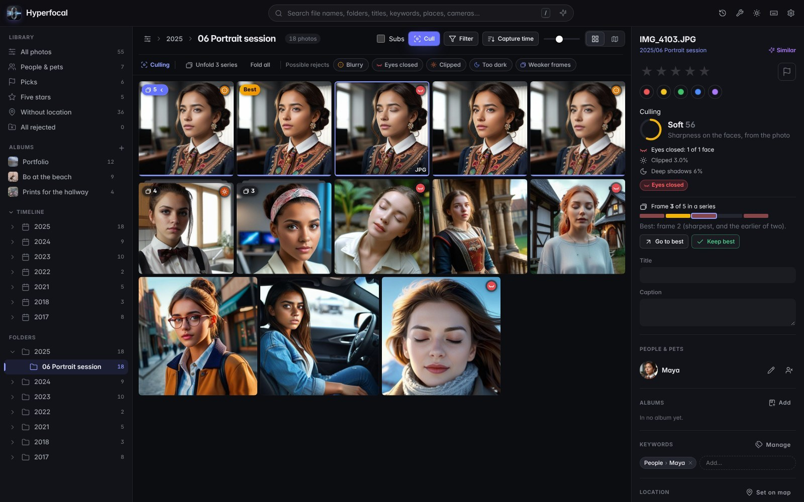

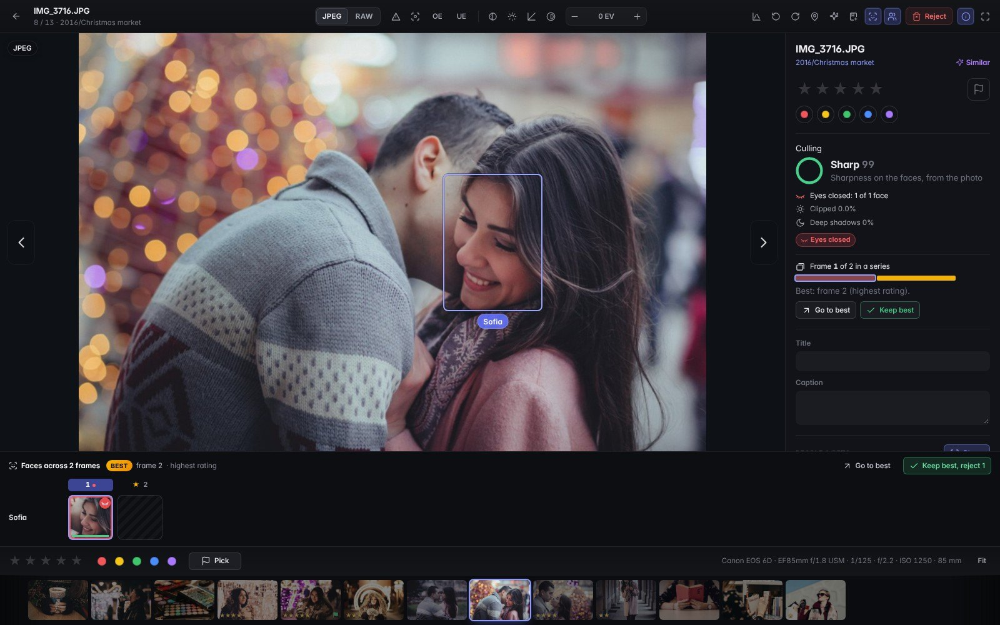

| RAW view with over/underexposure and the RAW histogram | Locations |
| --- | --- |
|  | 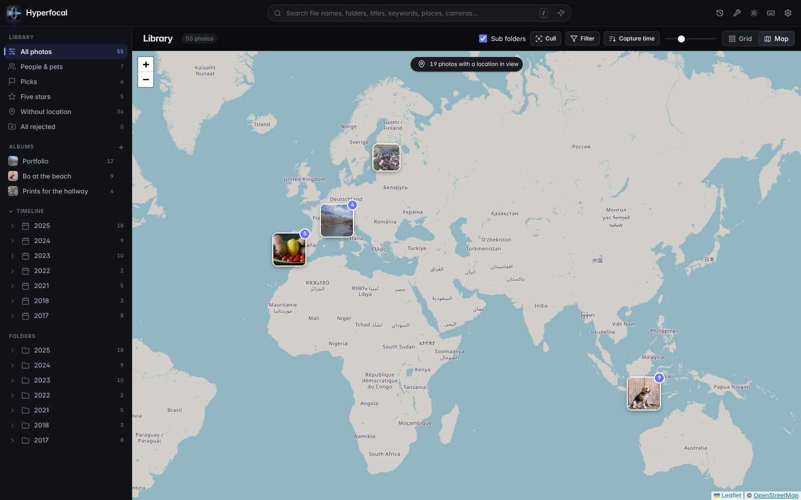 |

| Search by content: “a cat sleeping on a bed” | An album, on its way to Immich |
| --- | --- |
| 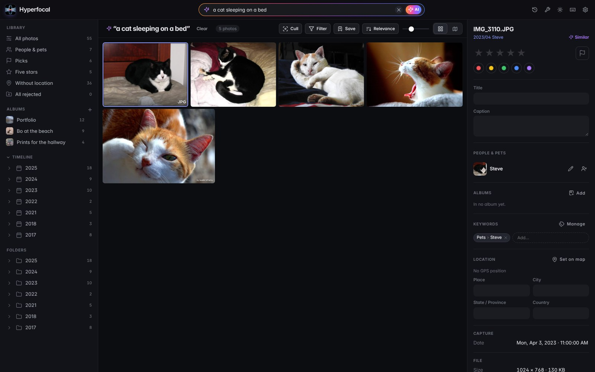 | 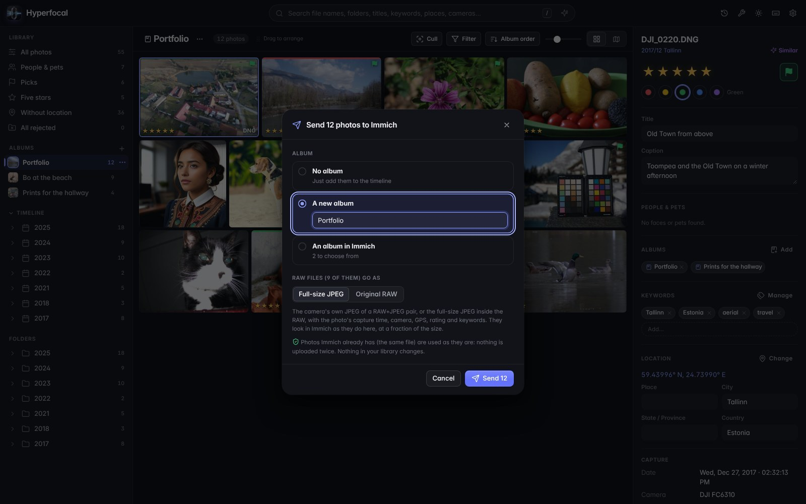 |

Mobile: grid, single view with the culling bar, view tools:


Culling on a phone: an unfolded series, the frame where she blinked, and its measurements:

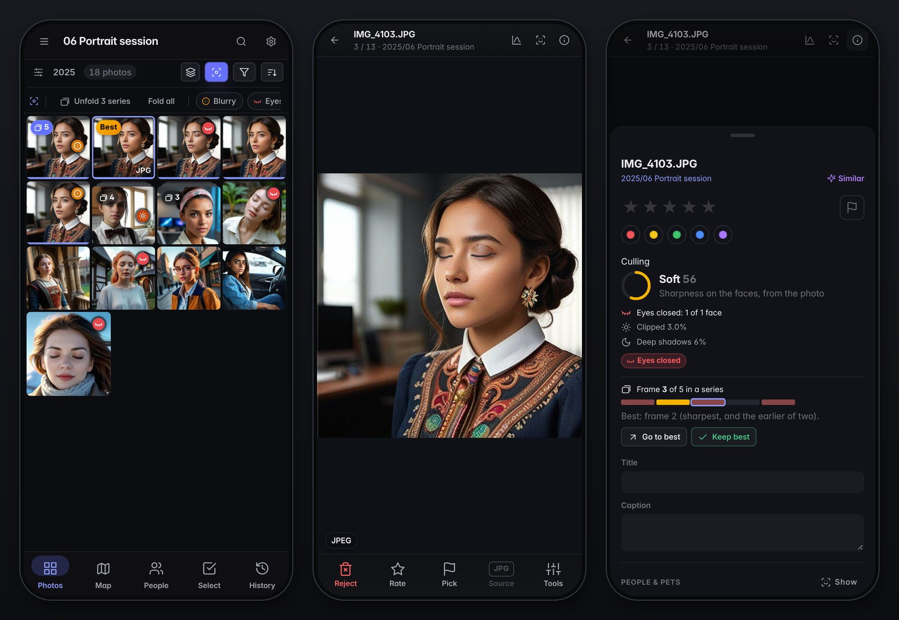

People & pets: the people found and named, with the suggestions waiting for review, and a dog named in the single view (`Shift+F` shows the boxes):

| People | Pets |
| --- | --- |
| 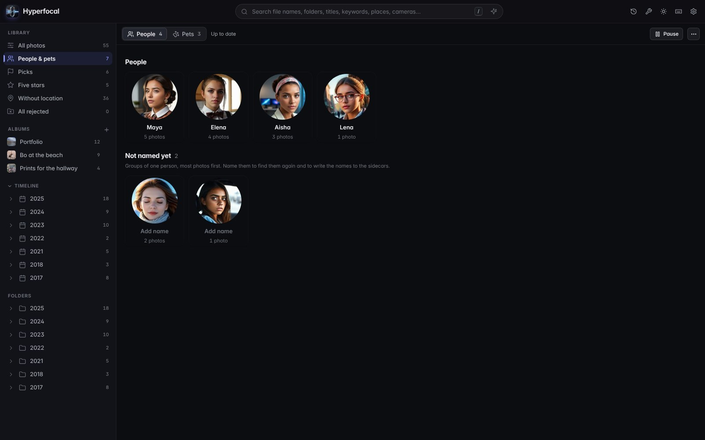 | 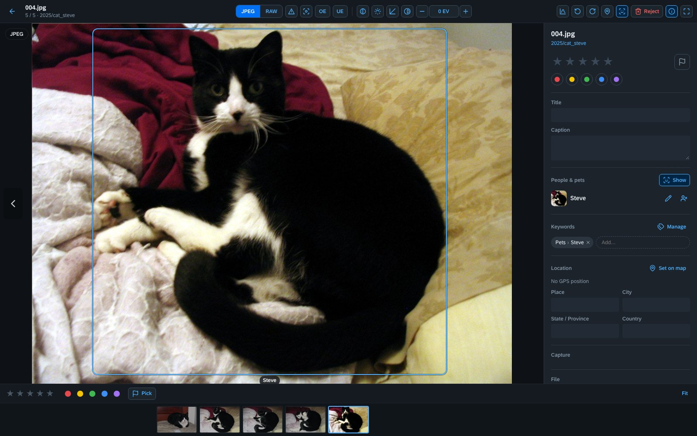 |

A cat's face the face detector took for a person's, set right from its menu (it is then matched to the cat's other photos):

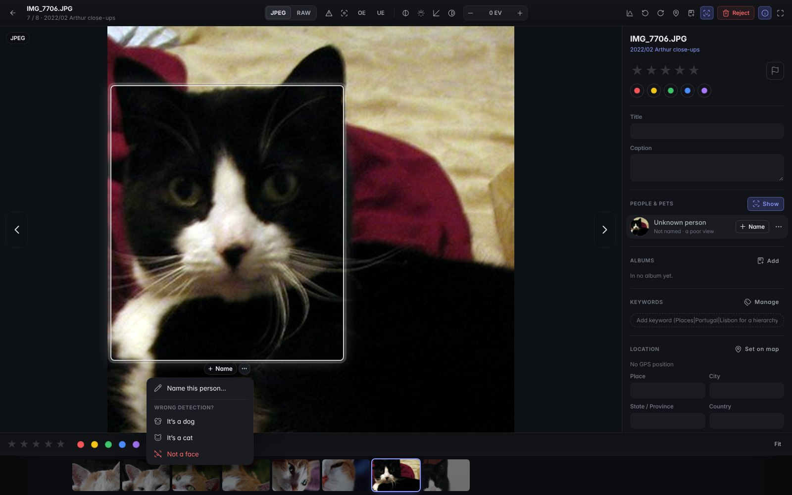

On a phone: the people, the pets, and a person's suggestions to review:

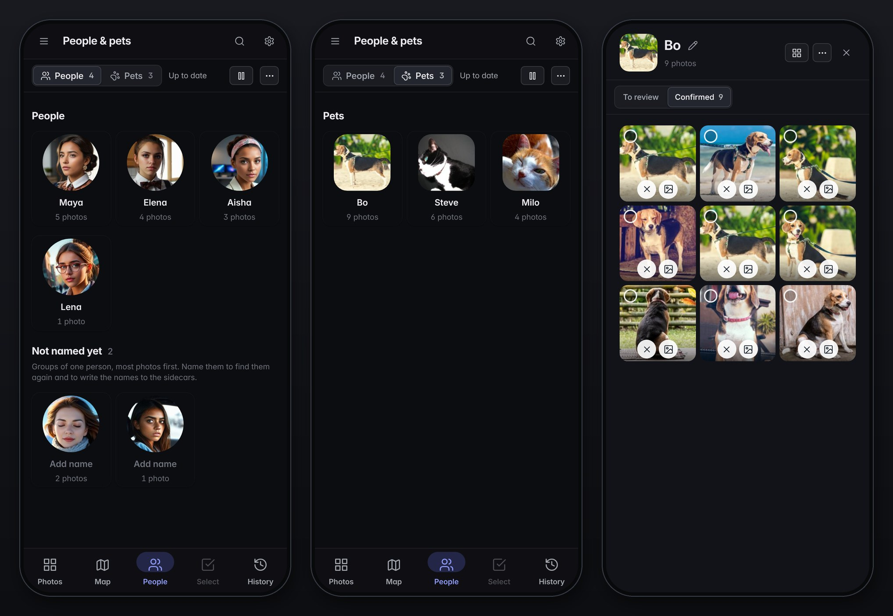

Duplicates: a folder of exports checked against the rest of the library (a mirrored and a turned copy, each with its RAW), and on a phone exact copies, near-duplicates and a pair in the compare view:

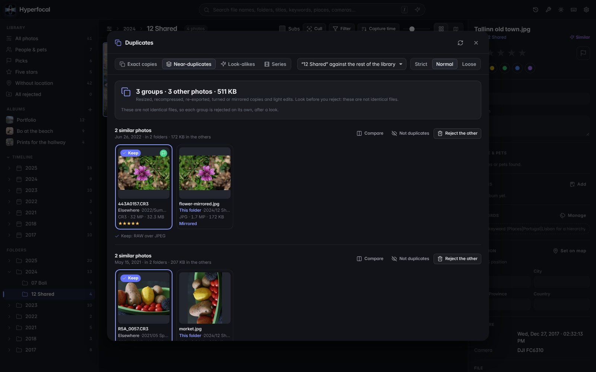

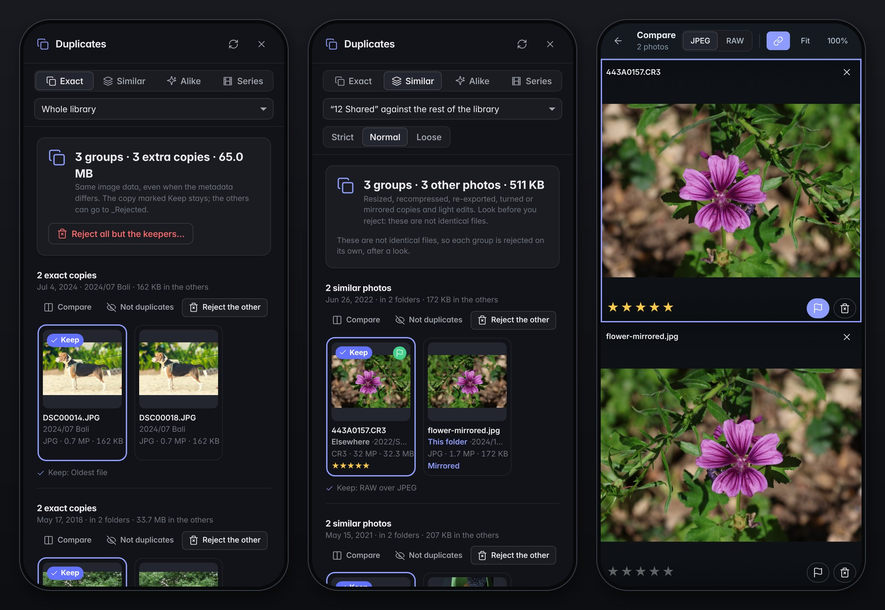

<sub>The demo library is made of CC0 sample RAW files from [raw.pixls.us](https://raw.pixls.us/); CC0 photos of pets by D Coetzee, iezalel williams, Artem Beliaikin and Mustang Joe (Flickr, found with [Openverse](https://openverse.org/)); and AI-generated portraits of no real person from the [Open and Closed Eyes Dataset](https://huggingface.co/datasets/MichalMlodawski/closed-open-eyes) by Michał Młodawski (ODC-By 1.0), with blinks and blur added for the culling screenshots. Names are invented.</sub>

## Install on Unraid

1. Open a terminal on the server (the `>_` icon in the Unraid web UI) and save the template:
   ```bash
   wget -O /boot/config/plugins/dockerMan/templates-user/my-Hyperfocal.xml \
     https://raw.githubusercontent.com/au12/Hyperfocal/main/unraid/hyperfocal.xml
   ```
   Or copy [`unraid/hyperfocal.xml`](unraid/hyperfocal.xml) to that path by hand.
2. Go to **Docker**, click **Add Container**, and choose **Hyperfocal** in the **Template** list.
3. Set **Photo library** to the share that holds your Year folders, for example `/mnt/user/Photos`.
4. Keep **AppData** on your cache pool. The index database and the thumbnail cache live there. `/mnt/cache/appdata/hyperfocal` is best if `appdata` is not an exclusive share. Thumbnails are kept in a few large pack files (512 MB each), not one file per photo, so appdata backups copy them at disk speed; the `cache` folder can still be left out of backups, since it is rebuilt by itself.
5. Click **Apply**, then open the web UI.

The first scan indexes metadata only and reads very little of each file. Thumbnails are built in the background, newest years first. Any folder you open is indexed immediately, ahead of the queue.

The image is `ghcr.io/au12/hyperfocal:latest` (amd64). It is rebuilt on every push to `main` that changes the server, the web UI or the image, and from scratch once a week, so security fixes in Debian's packages (including libheif and LibRaw) reach it without a code change. Tags `vX.Y.Z` are releases: they also run the major tests (the 300,000-photo library and fuzzing) and are published as versioned images. In a public repository, GitHub pauses scheduled workflows after 60 days without activity; if that happens, re-enable the **Docker** workflow in the **Actions** tab.

The container package has the same visibility as the repository. If the repository is private, the image is private too. In that case, either make the package public (GitHub → Packages → hyperfocal → Package settings) or run `docker login ghcr.io` on the server with a token that has `read:packages`.

## Docker Compose

```yaml
services:
  hyperfocal:
    image: ghcr.io/au12/hyperfocal:latest
    container_name: hyperfocal
    ports:
      - "8080:8080"
    volumes:
      - /mnt/user/Photos:/photos             # add :ro for a pure viewer
      - /mnt/user/appdata/hyperfocal:/config
    environment:
      PUID: "99"
      PGID: "100"
      UMASK: "000"
      # HYPERFOCAL_PASSWORD: "change-me"
      # AI features (on by default; models download into /config/ml on first use):
      # HYPERFOCAL_ML: "false"            # turn them all off
      # HYPERFOCAL_ML_DEVICE: "auto"      # cpu, cuda or auto
      # Send to Immich (optional, see below):
      # HYPERFOCAL_IMMICH_URL: "http://immich-server:2283"
      # HYPERFOCAL_IMMICH_API_KEY: "..."
      # HYPERFOCAL_IMMICH_LIBRARY_PATH: "/mnt/media/photos"   # if Immich reads this library
    restart: unless-stopped
    # An NVIDIA GPU for the AI features (NVIDIA Container Toolkit, driver 580 or newer):
    # deploy:
    #   resources:
    #     reservations:
    #       devices:
    #         - driver: nvidia
    #           count: 1
    #           capabilities: [gpu]
```

## Behind Nginx Proxy Manager

Add a proxy host pointing at `http://<unraid-ip>:8080`. Nothing else is required. The live-update stream sends `X-Accel-Buffering: no`, so nginx does not buffer it.

To keep it LAN-only, add an Access List in NPM that allows only your LAN subnet and denies everything else, and attach it to the host, or give it a DNS name that only resolves inside your network. Set `HYPERFOCAL_PASSWORD` if other people share the network.

The browser fetches the map tiles and the place search directly from OpenStreetMap (`tile.openstreetmap.org`, `nominatim.openstreetmap.org`). Nothing else leaves your network.

## Working alongside Excire Foto, Lightroom and Bridge

Hyperfocal reads EXIF, embedded XMP and sidecar XMP, in that order, so sidecar values win. It writes standard fields:

| What | XMP field | Read by |
| --- | --- | --- |
| Rating | `xmp:Rating` | Excire, Lightroom, Bridge, Capture One, darktable |
| Colour label | `xmp:Label` (`Red`, `Yellow`, …; localized names such as `Rot` are read too) | Excire, Lightroom, Bridge |
| Pick flag | `xmpDM:pick`, the field Lightroom Classic 13.2+ uses | Lightroom |
| Reject rating (`Alt+Delete`) | `xmp:Rating` = −1, Bridge's reject | Bridge |
| Keywords | `dc:subject` and `lr:hierarchicalSubject` | all of the above |
| Title, caption, creator, copyright | `dc:title`, `dc:description`, `dc:creator`, `dc:rights` | all of the above |
| Location | `exif:GPS*`, `photoshop:City/State/Country`, `Iptc4xmpCore:Location/CountryCode` | all of the above |
| People and pets | `People\|Name` and `Pets\|Name` keywords; MWG regions (`mwg-rs:Regions`, type `Face` or `Pet`); `Iptc4xmpExt:PersonInImage` | Keywords: all of the above. Regions: Lightroom Classic, digiKam |

Sidecars are named `IMG_1234.xmp`, the Adobe convention that Excire also uses. Darktable- and digiKam-style `IMG_1234.CR3.xmp` sidecars are renamed to `IMG_1234.xmp` when the folder is scanned, so Excire and Lightroom see their ratings and keywords too. The content is not touched. A sidecar is only renamed when nothing can mix: the photo is the only one with that name (apart from its JPEG/HEIF twin) in its folder and `_Rejected`, and no `IMG_1234.xmp` exists yet. When one does, both files stay and `IMG_1234.xmp` is used. Each rename shows up in the history and can be undone, which keeps the old name for good. Set `HYPERFOCAL_RENAME_SIDECARS=false` if you still edit in darktable: it keeps its edit history in that file and only looks for it under the darktable name.

A RAW and a JPEG or HEIF with the same name in the same folder are one photo, shown once with a `CR3+JPG` badge, and share `IMG_1234.xmp`. Two *different* photos with the same name never share a sidecar: `IMG_1234.xmp` belongs to the RAW (a camera RAW before a DNG, then JPEG, HEIF, TIFF, PNG), and the other photo gets its own, such as `IMG_1234.TIF.xmp` for a TIFF saved under the RAW's name or `IMG_1234.DNG.xmp` for a DNG converted from a CR3. This holds while either one is in `_Rejected`, so a reject or restore never changes which sidecar a photo uses.

**Excire Foto setup for two-way sync:**

- **Enable "Always use sidecar files"** in Excire's settings. Excire always writes RAW metadata to sidecars, but by default it writes JPEG and DNG metadata into the file itself. Hyperfocal never writes into your DNGs, so with this option on, both apps use the same sidecar for DNGs too.
- **Enable "Load keywords from analyzed photos"** on the Metadata tab of Excire's settings, so Excire reads keywords that are already in your files.
- Excire keeps its changes in its own database until you save them. Use **Save Metadata** to write Excire's edits to the sidecars; Hyperfocal picks them up on the next rescan, or as soon as you open the folder. Use **Load Metadata** in Excire to pull in changes made in Hyperfocal.

Lightroom works the same way: use *Metadata → Save Metadata to File* and *Read Metadata from File*.

## Keyboard shortcuts

The FastRawViewer preset is the default. Press `?` or `F1` in the app for the full list, where any shortcut can also be changed (click **+** and press the new key; a key already in use asks before it moves) or reset to the defaults. Switch to the Lightroom / Excire preset there or under Settings; your own changes are kept per preset, in the browser.

| Action | FastRawViewer preset | Lightroom / Excire preset |
| --- | --- | --- |
| Next / previous photo | `→` / `←` `Backspace` | same |
| Open / back to grid | `Enter` / `Esc`, `G` | same |
| Full screen on / off (`Esc` keeps it on; in the library, `Esc` twice quickly leaves it) | `F` | same |
| RAW ↔ embedded JPEG | `J` | `J` |
| Fit ↔ 100 % at the mouse (grid: open photo) | `Z` or `Space` | same |
| Compare the selected photos (2–4) | `C` or `N` | same |
| Compare: active photo / step it through the folder | `←` `→` / `↑` `↓` | same |
| Screen sharpening (off / 1 / 2) | `S` | `S` |
| Focus peaking | `P` | `Shift+P` |
| Overexposure / underexposure | `O` / `U` | `O` / `Shift+U` |
| Shadow boost / highlight inspection / linear | `Shift+S` / `Shift+H` / `L` | same |
| Invert colours | `Shift+I` | same |
| Exposure ±⅓ EV, ±1 EV, on/off, reset (or double-click the EV readout) | `Alt+=` `Alt+-`, `Ctrl+Alt+=` `Ctrl+Alt+-`, `A`, `Shift+A` | same |
| Histogram / info panel | `H` / `I` | same |
| Sidebar / hide all panels | `F7` / `Tab` | same |
| Rating | `0`–`5` | `0`–`5` |
| Colour label | `6` red, `7` yellow, `8` green, `9` blue | same |
| Pick / unflag | `Alt+P` or `` ` `` / `Alt+U` | `P` / `U` |
| Reject (move to `_Rejected`) | `Delete` | `X` or `Delete` |
| Keywords / location / title | `K` / `Shift+L` / `Alt+D` | same |
| Undo | `Ctrl+Z` | `Ctrl+Z` |
| Locations (map) / back to the photos | `M` | `M` |
| People & pets | `Shift+P` | `Shift+Y` |
| Faces and pets on the photo | `Shift+F` | `Shift+F` |
| Culling on / off | `Shift+C` | `Shift+C` |
| Unfold / fold the series | `Shift+G` | `Shift+G` |
| Faces side by side, across the series | `V` | `V` |
| Keep the best of the series, reject the others | `Shift+K`, `Ctrl+Shift+K` | `Shift+K`, `Ctrl+Shift+K` |
| Review the series frame by frame (`←`/`→` frames, `↑`/`↓` series, `Esc` back) | `R` | `R` |
| Add to the last album / to an album… / take out of the album | `B` / `Shift+B` / `Alt+B` | same |
| Search | `/` | `/` |

Full screen works like a desktop app: `Esc` keeps its usual meaning and does not leave it. Chromium browsers (Chrome, Edge, Brave, Arc) allow this over HTTPS or on localhost; holding `Esc` for two seconds still leaves, which the browser does not let pages change. Firefox always leaves on `Esc` unless `browser.fullscreen.exit_on_escape` is set to `false` in about:config. Safari always leaves.

## Configuration

| Variable | Default | Meaning |
| --- | --- | --- |
| `HYPERFOCAL_PHOTOS` | `/photos` | Library root inside the container |
| `HYPERFOCAL_CONFIG` | `/config` | Index database, caches, sidecar backups, journal |
| `HYPERFOCAL_CACHE` | `$HYPERFOCAL_CONFIG/cache` | Thumbnail and preview cache |
| `HYPERFOCAL_PORT` | `8080` | HTTP port |
| `HYPERFOCAL_PASSWORD` | – | Optional single password for the UI |
| `HYPERFOCAL_READONLY` | `false` | `true` disables every write |
| `HYPERFOCAL_RENAME_SIDECARS` | `true` | Rename darktable/digiKam-style `IMG_1234.CR3.xmp` sidecars to `IMG_1234.xmp` (see [Working alongside Excire Foto](#working-alongside-excire-foto-lightroom-and-bridge)) |
| `HYPERFOCAL_REJECT_DIR` | `_Rejected` | Reject sub-folder name. `_rejected` in any case is always treated as a reject folder. |
| `HYPERFOCAL_RESCAN_MINUTES` | `15` | Full re-check interval (`0` = only at start-up) |
| `HYPERFOCAL_PREGEN_THUMBS` | `true` | Build all thumbnails in the background |
| `HYPERFOCAL_PREGEN_PREVIEWS` | `true` | At idle, make screen-size previews of recent imports ahead of time, within the preview disk budget |
| `HYPERFOCAL_PREGEN_DAYS` | `14` | How far back "recent imports" goes, in days |
| `HYPERFOCAL_RAW_CACHE_MB` | `1536` | RAM for developed RAW data |
| `HYPERFOCAL_PREVIEW_CACHE_MB` | `4096` | Disk budget for screen-size previews |
| `HYPERFOCAL_INDEX_THREADS` | cores, 2–8 | Parallel metadata readers |
| `HYPERFOCAL_DECODE_CONCURRENCY` | cores ÷ 4, 1–4 | RAW files developed at once |
| `HYPERFOCAL_RAW_DECODER` | `auto` | `auto`: FlashRaw, with LibRaw when FlashRaw cannot read a file. `libraw`: LibRaw for every RAW file. |
| `HYPERFOCAL_INTEGRITY` | `true` | Archive integrity monitor: hash every original and verify it again over time |
| `HYPERFOCAL_VERIFY_DAYS` | `90` | Every original is verified once in this many days |
| `HYPERFOCAL_VERIFY_HOUR` | `4` | Start of the nightly verification window (local hour; set `TZ`) |
| `HYPERFOCAL_VERIFY_MINUTES` | `120` | Length of the nightly window. Outside it, new and changed files are still hashed, at most 4 GB an hour. |
| `HYPERFOCAL_HASH_MBPS` | `60` | Read rate while hashing, MB/s (`0` = unlimited). Reading pauses while you are viewing photos. |
| `HYPERFOCAL_CULL` | `true` | Culling help: measure every photo once in the background (sharpness of the subject from the RAW, clipping, and closed eyes with the AI features) for stacks, possible rejects and the best frame of a series |
| `HYPERFOCAL_DUPES` | `true` | Duplicates report: fingerprint every photo's thumbnail in the background, for near-duplicates and series (exact copies need only the integrity monitor) |
| `HYPERFOCAL_ALERT_URL` | – | Where integrity alerts go: an ntfy topic URL, a Gotify `…/message` URL, or any webhook |
| `HYPERFOCAL_ALERT_FORMAT` | `auto` | `ntfy`, `gotify` or `json` (`auto` decides from the URL) |
| `HYPERFOCAL_ALERT_TOKEN` | – | Access token for the alert service (ntfy token, Gotify app token, or a bearer token for a webhook) |
| `HYPERFOCAL_ML`, `HYPERFOCAL_ML_DEVICE`, … | | The AI features: see [Setting it up](#setting-it-up) |
| `HYPERFOCAL_PEOPLE_XMP` | `true` | Write confirmed names to the sidecars (`false`: names stay in the index) |
| `HYPERFOCAL_ML_SIZE` | `2048` | Long side of the image analysed for faces and pets, px |
| `HYPERFOCAL_ML_CONCURRENCY` | `2` | Photos prepared for the AI engine at once |
| `HYPERFOCAL_IMMICH_URL` | – | Send to Immich: the Immich server as Hyperfocal reaches it, e.g. `http://192.168.1.10:2283` |
| `HYPERFOCAL_IMMICH_API_KEY` | – | An Immich API key (Account settings → API keys) with `asset.read`, `asset.upload`, `album.read`, `album.create` and `albumAsset.create` |
| `HYPERFOCAL_IMMICH_LIBRARY_PATH` | – | Where Immich sees this photo folder, if it reads it as an external library (e.g. `/mnt/media/photos`): photos it has are then found by path instead of uploaded |
| `HYPERFOCAL_IMMICH_PUBLIC_URL` | the URL above | Immich's address for links in the browser, when the one above is internal |
| `HYPERFOCAL_DEBUG` | `false` | `true`: debug mode, detailed telemetry for finding errors, slow spots and where memory and battery go (see [Debug mode and telemetry](#debug-mode-and-telemetry)); `trace` also records trace-level log events |
| `HYPERFOCAL_DEBUG_MAX_MB` | `1024` | Disk budget for debug mode's files in `AppData/debug` (the oldest days go first) |
| `HYPERFOCAL_DEBUG_DAYS` | `30` | Debug mode's files older than this are deleted |
| `HYPERFOCAL_DEBUG_INTERVAL` | `30` | Seconds between debug mode's samples of the process, the container and every background pass |
| `TZ` | `UTC` | Time zone of the container, for the nightly window (for example `Europe/Lisbon`) |
| `PUID` / `PGID` | `99` / `100` | User and group the app runs as (Unraid `nobody:users`) |
| `UMASK` | `000` | `000` matches Unraid share permissions, so Excire can still edit sidecars over SMB |

Viewer and culling preferences are set per browser in the app's Settings dialog. They include the theme, shortcut preset and your own shortcuts, whether single view opens as JPEG or RAW, where full-resolution RAW is demosaiced, auto-advance, prefetch depth, sharpening strengths, the peaking colour, the over- and underexposure styles and offline copies.

## Performance

These numbers are from a 2-vCPU test VM; an Unraid server will be faster.

| Operation | Time |
| --- | --- |
| Embedded full-size JPEG | 2–5 ms |
| Screen-size preview, first time | 60–105 ms (then cached on disk) |
| First RAW render, half-size development | 180–550 ms |
| Half-size development of a 24 MP frame (after decoding) | 31 ms |
| Switching between view tools | 30–70 ms |
| Clipping mask | 4 ms |
| Full-resolution RAW tile (512×512, RCD), on the server | 10 ms |
| Culling measurements of a RAW file (development, sharpness, clipping), in the background | 0.3–0.4 s |
| A closed-eyes check, per face (AI engine, CPU) | about 25 ms |
| RAW view of the next photo, when the view left the one before mid-development | as fast as on an idle server (was 20–55% slower) |
| First RAW view while culling develops a photo in the background | as fast as on an idle server (was 25–55% slower) |

A RAW development nobody waits for any more is stopped. When the single view moves past a photo before its RAW view is ready, FlashRaw lets go of the cores within a few milliseconds (a few tens for some CR2 and DNG files) instead of finishing a development nobody will see, and the culling pass stops the one it is in the middle of as soon as you open a RAW view (it makes it again later). A photo's render, RAW info and clipping mask share one development, which carries on while any of them still waits. Measured with Canon R6 and R5 CR3, 5D Mark IV CR2 and Pentax K-1 II DNG files.

Thumbnails and previews made in the background are encoded with mozjpeg's trellis quantization (pure Rust): at the same SSIMULACRA2 score as libjpeg-turbo, thumbnails are about 12% smaller and 2048-pixel previews about 7% smaller (up to 26%), measured on real photos. Images made while you wait (a preview opened before it was made, tiles, RAW renders) still use libjpeg-turbo, which encodes about 15 times faster. WebP was measured too and rejected: 4% smaller at best, inconsistent, and 25 times slower to encode.

Thumbnails live in append-only pack files with a checksum per record: a request is one positioned read, start-up reads a small hint file per pack instead of 300,000 directory entries, and thumbnails of photos that changed or left the library are cleared out in the background (a pack that is mostly garbage is rewritten). Thumbnails from before are moved into packs on the first start.

The server is a single Rust binary (axum, SQLite in WAL mode, FlashRaw, libjpeg-turbo with SIMD). The RAW development pass is written as plain loops the compiler vectorises (SSE2, or NEON on ARM), with an AVX2 copy picked at run time on CPUs that have it; the log says which one runs. The UI is about 70 KB of compressed Svelte 5; the map loads only when you use it. The image is Debian slim plus ExifTool, which is used only to write sidecars, and libheif and LibRaw for the helper process.

Culling's first pass measures about 200 RAW files a minute on that VM, so 300,000 photos take about a day; it works newest first, photos on screen jump the queue, and it pauses while you view photos. New imports are measured within minutes.

On the same VM, the LibRaw helper starts in a few milliseconds, and a LibRaw development takes 0.1–2 s depending on sensor size. A HEIC thumbnail or preview costs one HEVC decode, about 0.5 s for a 12-megapixel photo; after that it is cached like everything else.

## Limitations

- The RAW view is developed at half resolution (a 2×2 Bayer quad per pixel) until you zoom in to 75% or more; then Bayer sensors are shown at full resolution, tile by tile. X-Trans and other non-Bayer sensors stay at half resolution: for pixel-level checks on those, the embedded JPEG view shows the camera JPEG at full resolution.
- Fujifilm X-Trans, monochrome and linear DNG files use an approximate development path, about 0.6–0.9 s.
- HEIC/HEIF files get the image view, metadata and every culling feature, but none of the RAW tools: they hold no sensor data.
- LibRaw 0.21, the version in the Docker image, has no colour data for some cameras released after 2022. FlashRaw handles those, but if LibRaw has to take over for one, its RAW view can look flat in colour.
- The AI features download their models once (about 1.7 GB with all of them on), and a first analysis takes a while on a CPU (see [Speed](#speed)). Telling apart two pets of the same breed and colour is harder than telling people apart: expect more suggestions to review.
- Hyperfocal does no AI keywording: search by content and *Find similar* find photos by what they show without writing keywords. Keep Excire for keywords for now.
- Culling measures sharpness on the half-size development (and a JPEG at about 3000 pixels): it catches a missed focus, shake and motion blur, but to choose between two sharp frames, look at 100%. Faces smaller than 64 pixels there are not measured, and eyes looking down can count as closed.
- Near-duplicates compare a perceptual hash of each thumbnail (and of it turned and mirrored): resized, recompressed, re-exported, lightly edited, turned and mirrored copies are found; crops are found by look-alikes, which need search by content. The Duplicates report's series keeper is the sharpest frame by an estimate from the thumbnail; culling's stacks use the measurements above.

## Troubleshooting a file

`hyperfocal inspect` shows what every decoder makes of a file: metadata from FlashRaw and LibRaw, both developments with timings and clipping, the embedded previews, and for HEIC the decoded size and colour space. It only reads the file.

```bash
docker exec hyperfocal hyperfocal inspect "/photos/2024/Trip/IMG_0001.CR3"
# add --render /config/inspect to also save the RAW developments as JPEGs
```

## Debug mode and telemetry

For finding what fails, what is slow, and where memory, CPU time and a phone's battery go, on your own library and devices. Set `HYPERFOCAL_DEBUG=true` (on Unraid: *Debug mode*, in the Advanced View) and restart the container. It is off by default, and off it costs nothing: each hook in the code is a single check.

It records, in `AppData/debug` (one NDJSON file per kind and day; at most `HYPERFOCAL_DEBUG_MAX_MB`, 1 GB, and `HYPERFOCAL_DEBUG_DAYS`, 30):

- **Errors.** Every warning and error, plus debug-level detail (a file that could not be read, a thumbnail that failed), grouped by the line of code that logged it, with counts and examples. Panics, and a run that ended without shutting down (a crash, or the container killed for memory), with its last known memory figures. HTTP errors with their message. From the index, every per-file error the scanner and the background passes recorded, grouped by message, file type and camera.
- **Speed.** Every request per route: count, p50/p95/max, bytes, transfers the browser gave up, and requests it gave up before the answer was ready. The work behind them: reading and decoding RAW files (per decoder) and developing them, the wait for a decoder, thumbnails and previews, JPEG encoding, metadata, the scanner, culling, the AI engine and its own steps, sidecar writes, hashing. Every SQL statement, with the rows its full scans walked.
- **Resources**, every `HYPERFOCAL_DEBUG_INTERVAL` seconds: CPU per thread pool, with wake-ups and time spent waiting for a CPU; memory split into what the app holds, what the allocator keeps after freeing, and mapped files; every memory cache with its hits, misses and evictions; the indexes held in memory; child processes (the AI engine, ExifTool); the container's memory limit, out-of-memory kills, CPU throttling and pressure stalls; disk reads; the GPU (with the NVIDIA runtime, every 2 minutes while the AI engine is loaded); the progress of every background pass.
- **Browsers.** Every browser with Hyperfocal open reports about once a minute while it is visible, and not at all while hidden: script errors and failed requests; how long the single view takes to show each photo (thumbnail, then preview, full JPEG or RAW); the grid's thumbnail loading; long tasks and the scripts behind them; slow taps and key presses; frames dropped while scrolling or panning; network use per route, with the server's share of each request's time (`Server-Timing`); event-stream traffic; memory (the JavaScript heap, decoded images, graphics); and the battery's level and drain where the browser tells (Chrome, Edge).

**Settings → Debug** shows the live picture, and:

- **Download report**: one `.tar.gz` with a one-page summary, a full JSON report (with a census of the library by file type and camera, which is to say by decoder path) and the telemetry files of the last days. Passwords, tokens and API keys are left out; folder and file names are in it. It is compressed: three busy days usually come to a few MB, rarely more than 20.
- **Copy summary**: the one-page summary as text, to paste into a conversation.
- **Mark a moment**: say what you saw ("the RAW view hung on this photo"); it is saved with what was on screen and what the server was doing, so it can be found in the timeline. Also from the bug tab on the left edge of the screen, or `Alt+Shift+M` (`⌥⇧M`) anywhere.
- **Release free memory**: asks the allocator to give back what it keeps after freeing, and says how much that was, which tells real memory use from memory merely held.

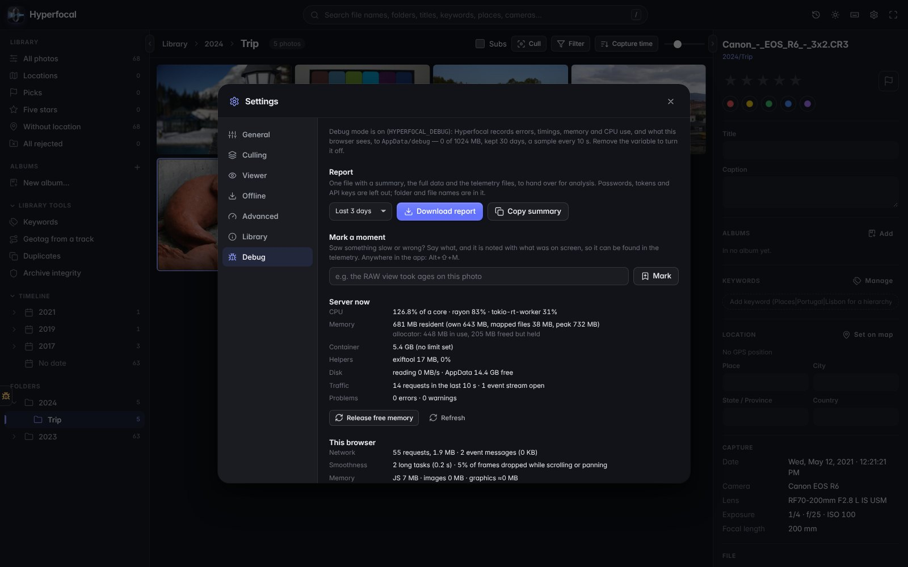

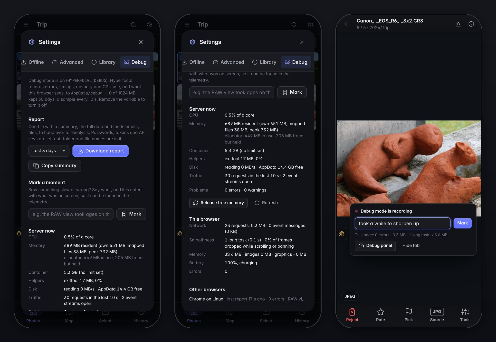

The same data is at `GET /api/debug/summary`, `/api/debug/live` and `/api/debug/bundle?days=3`, behind the login like the rest of the API. Remove the variable to turn debug mode off, and delete `AppData/debug` to remove its files.

## Development

```bash
# server (Rust 1.85+; cmake, nasm, pkg-config, libclang, libheif-dev, libraw-dev; exiftool at runtime)
#   Debian/Ubuntu: apt install cmake nasm pkg-config libclang-dev libheif-dev libheif-plugin-libde265 libraw-dev libimage-exiftool-perl
#   without libheif/LibRaw: cargo build --no-default-features (or --features heic / --features libraw)
cd server && cargo test && cargo run --release
#   env: HYPERFOCAL_PHOTOS=/path/to/library HYPERFOCAL_CONFIG=./dev HYPERFOCAL_WEB=../web/dist HYPERFOCAL_PORT=8099

# web UI (Node 20.19+)
cd web && npm ci && npm run dev     # proxies /api to :8099
npm run check && npm run build      # type check and production build (precompressed)

# 300,000-photo library test (release build)
cd server && cargo test --release --test large_library -- --ignored --nocapture

# fuzzing (nightly Rust and cargo-fuzz): one target per kind of file contents
cd server/fuzz && cargo +nightly fuzz list
cargo +nightly fuzz run xmp corpus/xmp seeds/xmp -- -max_total_time=60

# image
docker build -t hyperfocal .

# release: notes in docs/releases/v0.2.0.md, then bump the version (Cargo, npm) and commit
scripts/release.sh 0.2.0 && git push origin HEAD:main
#   the Release workflow tags the commit, publishes the GitHub release and starts the release
#   runs (major tests, then the versioned images); pushing a vX.Y.Z tag yourself also works

# AI engine: a development build downloads ONNX Runtime for the CPU into $HYPERFOCAL_CONFIG/ml
# along with the models; or point HYPERFOCAL_ORT_LIB at a libonnxruntime.so.1.29.0. The engine's
# tests run when HYPERFOCAL_ORT_LIB is set (the face, pet and search ones also want the
# downloaded models in HYPERFOCAL_TEST_ML_MODELS, e.g. ./dev/ml/models)
HYPERFOCAL_ORT_LIB=/path/to/libonnxruntime.so.1.29.0 cargo test ml::
# the GPU runtime: downloads it (1.3 GB) and checks its libraries link
cargo test --release --test ml_runtime -- --ignored --nocapture
```

The GitHub Action in `.github/workflows/docker.yml` runs the tests (including a smoke test of every fuzz target on mutated inputs) and the 300,000-photo library test, builds the image and publishes it to GHCR (the image build checks that ONNX Runtime loads and the bundled eye models give the right answers). `.github/workflows/fuzz.yml` fuzzes the parsers weekly and on every release. `.github/workflows/release.yml` turns a version bump on `main` into a release: the tag, the GitHub release with its notes, and the release runs of the other two. The HEIC and DNG test fixtures are generated by `server/tests/fixtures/make_fixtures.py`.

## Credits

- [FlashRaw](https://crates.io/crates/flashraw): RAW decoding
- [LibRaw](https://www.libraw.org/) (LGPL-2.1 / CDDL): fallback RAW decoding
- [libheif](https://github.com/strukturag/libheif) and [libde265](https://github.com/strukturag/libde265) (LGPL-3.0): HEIC/HEIF decoding
- [libjpeg-turbo](https://libjpeg-turbo.org/): JPEG decoding and encoding
- [ExifTool](https://exiftool.org/) by Phil Harvey: sidecar writing
- [Leaflet](https://leafletjs.com/) and [OpenStreetMap](https://www.openstreetmap.org/copyright): maps
- [Nominatim](https://nominatim.org/): place search
- [Inter](https://rsms.me/inter/) typeface by Rasmus Andersson (SIL Open Font License 1.1)
- [Augenblick](https://github.com/orohde/Augenblick): design inspiration
- [FastRawViewer](https://www.fastrawviewer.com/) and [Excire Foto](https://excire.com/): the workflows this follows
- People & pets models: [YuNet](https://github.com/opencv/opencv_zoo/tree/main/models/face_detection_yunet) (MIT), [AuraFace](https://huggingface.co/fal/AuraFace-v1) (Apache-2.0), [RF-DETR](https://github.com/roboflow/rf-detr) (Apache-2.0), [pet-recognition-base](https://huggingface.co/open-noodle/pet-recognition-base) (Apache-2.0), run with [ONNX Runtime](https://onnxruntime.ai/) (MIT) through [ort](https://ort.pyke.io/) (MIT/Apache-2.0), with preprocessing that follows [OpenCV](https://opencv.org/)'s (Apache-2.0)
- Eye checks: [MediaPipe Face Landmarker](https://ai.google.dev/edge/mediapipe/solutions/vision/face_landmarker) (Apache-2.0); search by content: [SigLIP 2](https://huggingface.co/google/siglip2-base-patch16-224) (Apache-2.0), with Hugging Face's [tokenizers](https://github.com/huggingface/tokenizers) (Apache-2.0)
- Photos in the screenshots: [raw.pixls.us](https://raw.pixls.us/) (CC0), CC0 pet photos from Flickr via [Openverse](https://openverse.org/), and AI-generated portraits from the [Open and Closed Eyes Dataset](https://huggingface.co/datasets/MichalMlodawski/closed-open-eyes) (ODC-By 1.0)

## License

MIT. See [LICENSE](LICENSE). The Docker image also contains LibRaw, libheif and libde265, used as unmodified shared system libraries under their own licenses, and ONNX Runtime's shared library (MIT) and the two MediaPipe models (Apache-2.0).
